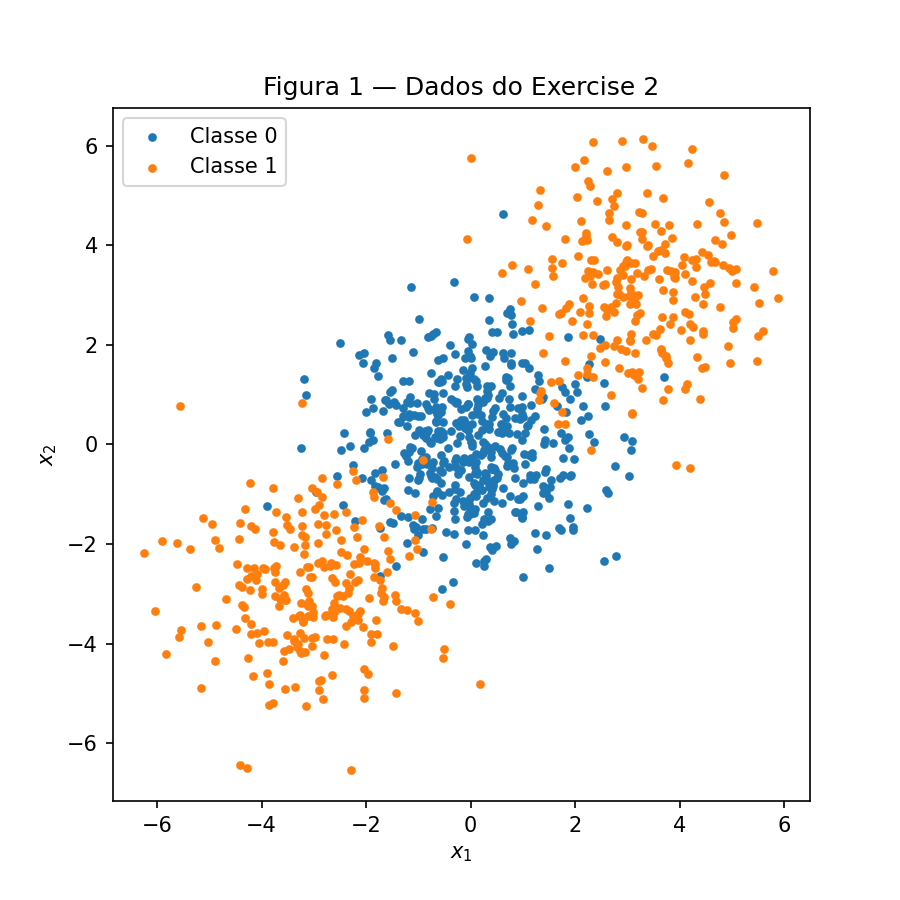
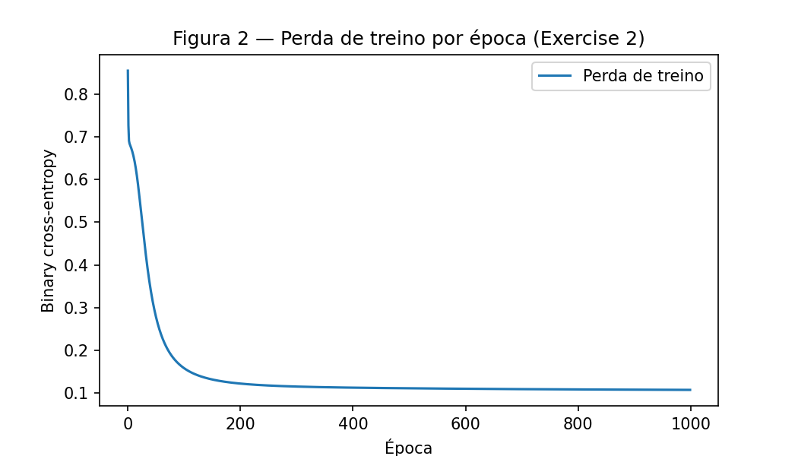
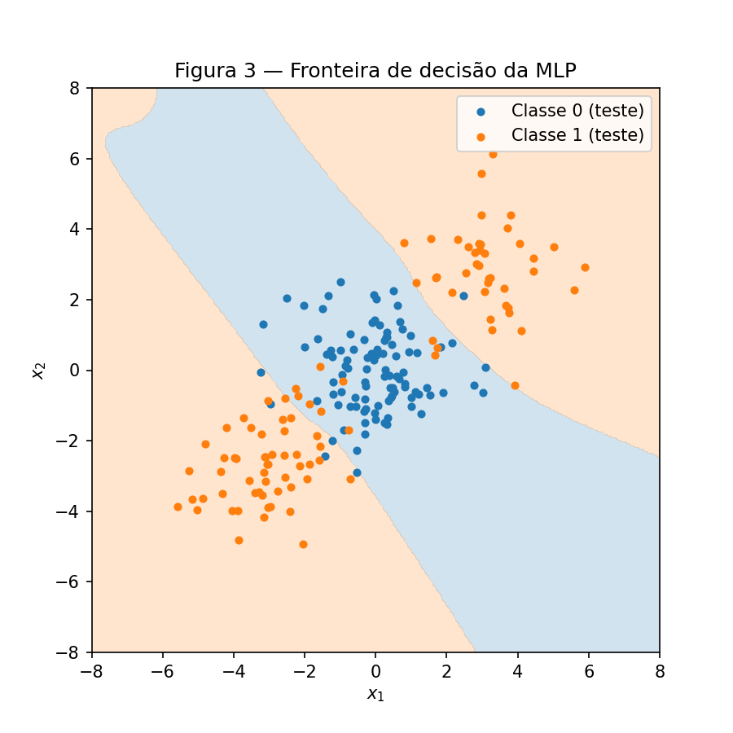
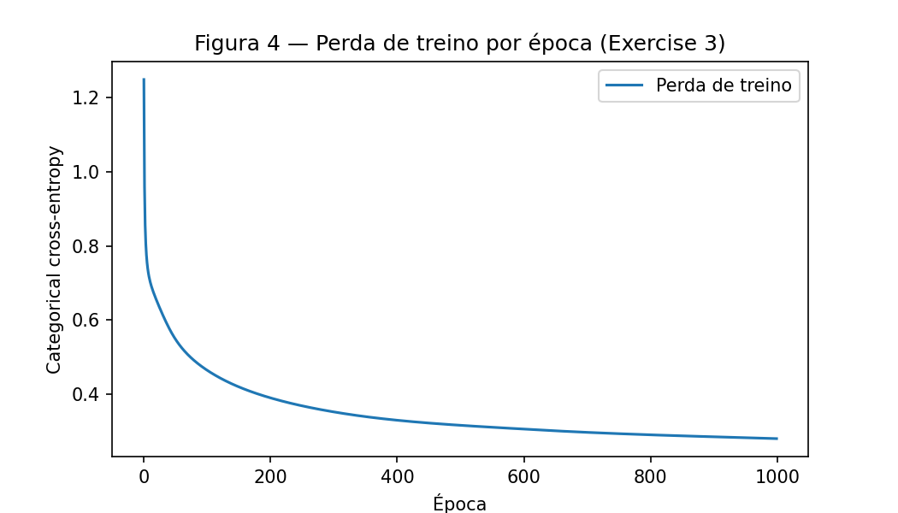
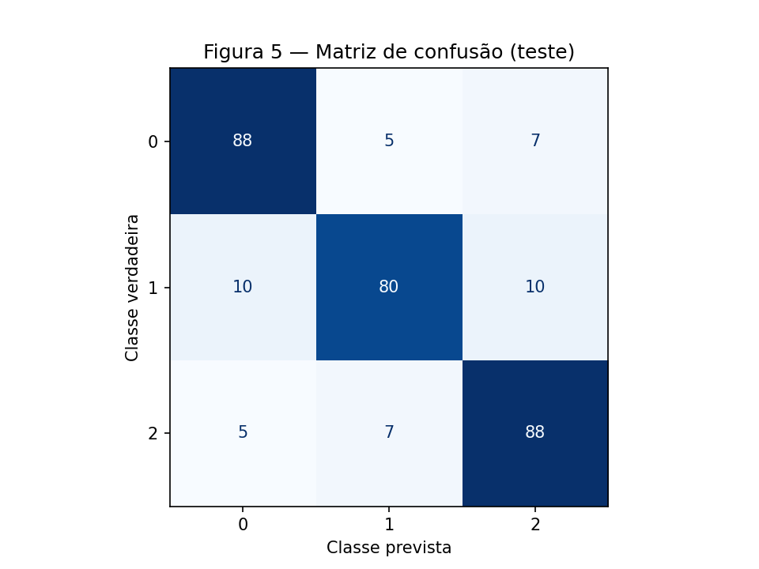
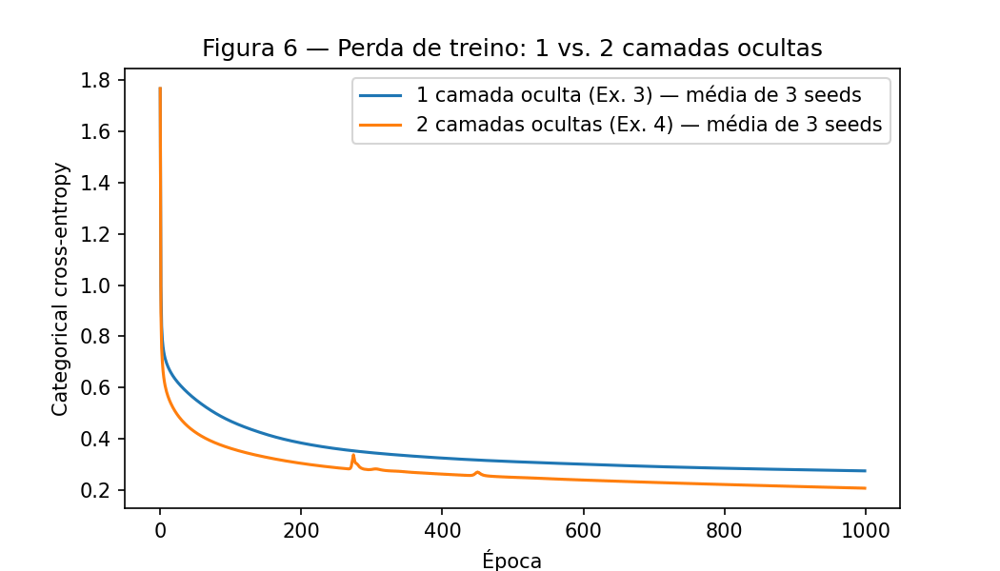

# 3. MLP

!!! abstract "Enunciado"

    [Exercises → MLP](https://insper.github.io/ann-dl/){:target='_blank'}

    O fio condutor da atividade é o que uma camada oculta acrescenta: um exercício à mão
    para ver a retropropagação mexer em cada parâmetro, depois um dataset que nenhuma reta
    separa, depois mais classes e, por fim, um quarto exercício que pergunta se empilhar
    uma segunda camada oculta traz algum ganho.

    **Regras técnicas (valem para toda a atividade):**

    - Fixar a semente com `rng = np.random.default_rng(42)` e usar o mesmo `rng` em todo o
      relatório;
    - Todo gráfico deve ter título, rótulos nos eixos e legenda das classes;
    - Bibliotecas permitidas: `numpy`, `pandas`, `matplotlib`/`seaborn` e `scikit-learn`
      apenas para gerar e dividir os dados (`make_blobs`, `make_classification`,
      `train_test_split`) e para a matriz de confusão. A MLP (ativações, perda, forward,
      gradientes e atualização) deve ser escrita pelo aluno. Sem TensorFlow, PyTorch ou
      `MLPClassifier`;
    - Todo número pedido (gradiente, acurácia, parâmetro atualizado) deve aparecer no texto,
      não só na saída do código;
    - Um título por exercício e um subtítulo por item, na ordem do enunciado. A última seção
      deve ser o *Results summary*.

---

## Exercise 1

!!! question "Enunciado — One Step of Backpropagation, by Hand"

    Considere uma MLP com 2 entradas, 1 camada oculta com 2 neurônios e 1 neurônio de saída.
    Use $\tanh$ como ativação nas duas camadas. A perda é o erro quadrático médio sobre uma
    única amostra ($N = 1$):

    $$
    L = \frac{1}{N}(y - \hat{y})^2 = (y - \hat{y})^2
    $$

    A derivada da $\tanh$ é $\frac{d}{du}\tanh(u) = 1 - \tanh^2(u)$. Use os valores:

    - Entrada e alvo: $x = [0.5,\ -0.2]$, $y = 1.0$
    - Pesos ocultos: $W^{(1)} = \begin{bmatrix} 0.3 & -0.1 \\ 0.2 & 0.4 \end{bmatrix}$
    - Bias ocultos: $b^{(1)} = [0.1,\ -0.2]$
    - Pesos de saída: $W^{(2)} = [0.5,\ -0.3]$
    - Bias de saída: $b^{(2)} = 0.2$
    - Taxa de aprendizado: $\eta = 0.3$

    Mostre todas as derivações e todos os números intermediários, com pelo menos 4 casas
    decimais. O exercício é feito no papel (ou em Markdown), não chamando uma biblioteca.

O script
[`code/exercise1_backprop_check.py`](https://github.com/Iamiran1/ann-dl/blob/main/docs/exercises/mlp/code/exercise1_backprop_check.py)
só confere as contas abaixo e usa apenas o módulo `math`.

??? example "Ver o código de conferência"

    ```{ .python .copy .select linenums='1' title="docs/exercises/mlp/code/exercise1_backprop_check.py" }
    --8<-- "docs/exercises/mlp/code/exercise1_backprop_check.py"
    ```

### A — Forward pass

!!! question "Enunciado"

    Calcule as pré-ativações ocultas $z^{(1)} = W^{(1)}x + b^{(1)}$, as ativações ocultas
    $h^{(1)} = \tanh(z^{(1)})$, a pré-ativação de saída $u^{(2)} = W^{(2)}h^{(1)} + b^{(2)}$,
    a saída $\hat{y} = \tanh(u^{(2)})$ e, por fim, a perda $L$.

$$
\begin{aligned}
z^{(1)}_1 &= 0.3 \cdot 0.5 + (-0.1)\cdot(-0.2) + 0.1 = 0.15 + 0.02 + 0.1 = 0.2700 \\
z^{(1)}_2 &= 0.2 \cdot 0.5 + 0.4 \cdot (-0.2) - 0.2 = 0.10 - 0.08 - 0.2 = -0.1800 \\
h^{(1)}_1 &= \tanh(0.2700) = 0.2636 \\
h^{(1)}_2 &= \tanh(-0.1800) = -0.1781 \\
u^{(2)} &= 0.5 \cdot 0.2636 + (-0.3)\cdot(-0.1781) + 0.2 = 0.1318 + 0.0534 + 0.2 = 0.3852 \\
\hat{y} &= \tanh(0.3852) = 0.3672 \\
L &= (1 - 0.3672)^2 = 0.6328^2 = 0.4004
\end{aligned}
$$

### B — Backward pass

!!! question "Enunciado"

    Calcule o gradiente da perda em relação a cada peso e cada bias. Comece por
    $\partial L / \partial \hat{y}$ e siga pela regra da cadeia: $\partial L / \partial u^{(2)}$
    (usando a derivada da $\tanh$); a camada de saída, $\partial L / \partial W^{(2)}$ e
    $\partial L / \partial b^{(2)}$; a propagação para trás, $\partial L / \partial h^{(1)}$ e
    $\partial L / \partial z^{(1)}$; e a camada oculta, $\partial L / \partial W^{(1)}$ e
    $\partial L / \partial b^{(1)}$.

**Saída.** Derivando a perda e passando pela $\tanh$ da saída:

$$
\begin{aligned}
\frac{\partial L}{\partial \hat{y}} &= -2(y - \hat{y}) = -2 \cdot 0.6328 = -1.2655 \\
\frac{\partial L}{\partial u^{(2)}} &= \frac{\partial L}{\partial \hat{y}}\,(1 - \hat{y}^2)
= -1.2655 \cdot (1 - 0.3672^2) = -1.2655 \cdot 0.8651 = -1.0948
\end{aligned}
$$

**Camada de saída.** Como $u^{(2)} = W^{(2)}_1 h^{(1)}_1 + W^{(2)}_2 h^{(1)}_2 + b^{(2)}$,
temos $\partial u^{(2)} / \partial W^{(2)}_j = h^{(1)}_j$ e
$\partial u^{(2)} / \partial b^{(2)} = 1$:

$$
\begin{aligned}
\frac{\partial L}{\partial W^{(2)}_1} &= -1.0948 \cdot 0.2636 = -0.2886 \\
\frac{\partial L}{\partial W^{(2)}_2} &= -1.0948 \cdot (-0.1781) = 0.1950 \\
\frac{\partial L}{\partial b^{(2)}} &= -1.0948
\end{aligned}
$$

**Propagação para a camada oculta.** Como $\partial u^{(2)} / \partial h^{(1)}_j = W^{(2)}_j$
(pesos ainda não atualizados) e $\partial h^{(1)}_j / \partial z^{(1)}_j = 1 - (h^{(1)}_j)^2$:

$$
\begin{aligned}
\frac{\partial L}{\partial h^{(1)}_1} &= -1.0948 \cdot 0.5 = -0.5474 \\
\frac{\partial L}{\partial h^{(1)}_2} &= -1.0948 \cdot (-0.3) = 0.3284 \\
\frac{\partial L}{\partial z^{(1)}_1} &= -0.5474 \cdot (1 - 0.2636^2) = -0.5474 \cdot 0.9305 = -0.5094 \\
\frac{\partial L}{\partial z^{(1)}_2} &= 0.3284 \cdot (1 - 0.1781^2) = 0.3284 \cdot 0.9683 = 0.3180
\end{aligned}
$$

**Camada oculta.** Como $z^{(1)}_i = W^{(1)}_{i1} x_1 + W^{(1)}_{i2} x_2 + b^{(1)}_i$, temos
$\partial z^{(1)}_i / \partial W^{(1)}_{ij} = x_j$ e $\partial z^{(1)}_i / \partial b^{(1)}_i = 1$:

$$
\begin{aligned}
\frac{\partial L}{\partial W^{(1)}_{11}} &= -0.5094 \cdot 0.5 = -0.2547 &
\frac{\partial L}{\partial W^{(1)}_{12}} &= -0.5094 \cdot (-0.2) = 0.1019 \\
\frac{\partial L}{\partial W^{(1)}_{21}} &= 0.3180 \cdot 0.5 = 0.1590 &
\frac{\partial L}{\partial W^{(1)}_{22}} &= 0.3180 \cdot (-0.2) = -0.0636 \\
\frac{\partial L}{\partial b^{(1)}_1} &= -0.5094 &
\frac{\partial L}{\partial b^{(1)}_2} &= 0.3180
\end{aligned}
$$

### C — Parameter update

!!! question "Enunciado"

    Com $\eta = 0.3$, aplique a descida do gradiente aos oito parâmetros
    ($\theta \leftarrow \theta - \eta\, \partial L / \partial \theta$). Informe o valor de
    cada parâmetro atualizado e diga se a perda subiria ou desceria em um segundo forward
    pass, e por quê.

| Parâmetro | Antes | Gradiente | Depois ($\theta - 0.3 \cdot$ gradiente) |
|---|---:|---:|---:|
| $W^{(1)}_{11}$ | 0.3000 | −0.2547 | 0.3764 |
| $W^{(1)}_{12}$ | −0.1000 | 0.1019 | −0.1306 |
| $W^{(1)}_{21}$ | 0.2000 | 0.1590 | 0.1523 |
| $W^{(1)}_{22}$ | 0.4000 | −0.0636 | 0.4191 |
| $b^{(1)}_1$ | 0.1000 | −0.5094 | 0.2528 |
| $b^{(1)}_2$ | −0.2000 | 0.3180 | −0.2954 |
| $W^{(2)}_1$ | 0.5000 | −0.2886 | 0.5866 |
| $W^{(2)}_2$ | −0.3000 | 0.1950 | −0.3585 |
| $b^{(2)}$ | 0.2000 | −1.0948 | 0.5284 |

**A perda desce.** Cada parâmetro andou no sentido contrário ao gradiente, que é o sentido
em que a perda diminui, e o passo $\eta = 0.3$ é pequeno o suficiente para não passar do
mínimo. Como $\hat{y}$ estava abaixo do alvo, a atualização aumenta $u^{(2)}$ e aproxima
$\hat{y}$ de 1. No segundo forward, $\hat{y}$ vai de 0.3672 para 0.7112 e a perda cai de
0.4004 para 0.0834.

---

## MLP usada nos Exercises 2, 3 e 4

A classe `MLP` foi escrita uma vez e é usada sem alterações nos três exercícios. O que muda
é passado como argumento: os tamanhos das camadas (`layer_sizes`) e o tipo de saída
(`"sigmoid"` com binary cross-entropy ou `"softmax"` com categorical cross-entropy). As
camadas ocultas usam $\tanh$, os pesos começam com valores aleatórios pequenos e o treino é
gradiente descendente com o conjunto de treino inteiro a cada época.

O `backward` repete os passos do Exercise 1 em forma matricial, para qualquer número de
camadas. Conferi os gradientes dele com gradientes numéricos (diferenças finitas) e a
diferença máxima foi da ordem de $10^{-10}$.

??? example "Ver o código completo — mlp.py"

    ```{ .python .copy .select linenums='1' title="docs/exercises/mlp/code/mlp.py" }
    --8<-- "docs/exercises/mlp/code/mlp.py"
    ```

---

## Exercise 2

??? example "Ver o código — exercise2_binary.py"

    ```{ .python .copy .select linenums='1' title="docs/exercises/mlp/code/exercise2_binary.py" }
    --8<-- "docs/exercises/mlp/code/exercise2_binary.py"
    ```

### A — Data

!!! question "Enunciado — Binary Classification a Straight Line Cannot Do"

    A classe 1 é dividida em dois clusters que ficam em lados opostos da classe 0, então
    nenhuma reta consegue separá-las. Use estes parâmetros, sem alterar:

    ```python
    from sklearn.datasets import make_blobs
    centers = np.array([[0., 0.], [3., 3.], [-3., -3.]])
    X, c = make_blobs(n_samples=[500, 250, 250], centers=centers,
                      cluster_std=1.2, random_state=42)
    y = (c > 0).astype(int)      # class 0: 1 cluster | class 1: 2 clusters
    ```

    Divida em 80% treino / 20% teste com
    `train_test_split(..., test_size=0.2, random_state=42, stratify=y)`. Produza a
    **Figura 1**: gráfico de dispersão dos 1000 pontos coloridos por `y`.

A classe 0 é o blob central (500 pontos) e a classe 1 são os dois blobs das pontas (250 +
250). O split dá 800 pontos de treino e 200 de teste.



/// caption
**Figura 1** — Os 1000 pontos coloridos pela classe.
///

### B — Linear baseline

!!! question "Enunciado"

    Antes de construir a rede, ajuste uma única fronteira linear no conjunto de treino e
    informe a acurácia de teste. Pode usar `sklearn.linear_model.LogisticRegression` aqui.
    O resultado deve ficar perto de 48%, pior que chutar. O item D pergunta sobre esse
    número.

A `LogisticRegression` tem **47.50 %** de acurácia no teste.

### C — MLP from scratch

!!! question "Enunciado"

    Escreva uma MLP do zero. A arquitetura é livre, mas precisa ter pelo menos uma camada
    oculta, e você deve implementar o forward pass, a perda (binary cross-entropy é a
    escolha natural), o backward pass (todos os gradientes derivados, sem autodiff) e a
    atualização dos parâmetros. Escreva como função ou classe que recebe os tamanhos das
    camadas como argumento, pois os Exercises 3 e 4 reutilizam o mesmo código.

    Treine por um número razoável de épocas (algumas centenas a alguns milhares),
    registrando a perda de treino a cada época. Informe a arquitetura, a taxa de
    aprendizado, o número de épocas e a acurácia de teste (uma implementação correta fica
    em torno de 90–93%). Produza a **Figura 2** (perda de treino × época) e a **Figura 3**
    (fronteira de decisão sobre os pontos de teste, avaliando a rede em uma grade e
    sombreando as duas regiões).

Arquitetura `[2, 8, 1]` (8 neurônios $\tanh$, saída sigmoide), binary cross-entropy,
$\eta = 0.5$ e 1000 épocas. Acurácia de **96.37 %** no treino e **92.00 %** no teste.



/// caption
**Figura 2** — Perda de treino por época.
///



/// caption
**Figura 3** — Regiões de decisão da MLP com os pontos de teste.
///

### D — Analysis

!!! question "Enunciado"

    Por que o baseline linear fica abaixo de 50% enquanto a MLP passa de 90%? Use a
    Figura 3: descreva a forma da região que a rede atribui à classe 1 e explique por que
    nenhuma reta consegue produzi-la.

Na Figura 3, a classe 0 fica com uma faixa diagonal no meio e a classe 1 com as duas
regiões de fora, uma de cada lado. Uma reta só divide o plano em dois lados, e não tem como
colocar os dois blobs da classe 1 do mesmo lado sem colocar junto o blob da classe 0, que
está entre eles. A MLP consegue porque cada neurônio oculto funciona como uma reta e a
saída combina essas retas; duas retas quase paralelas já formam a faixa.

A regressão logística fica abaixo de 50 % por causa da simetria: inclinar a reta para
acertar um dos blobs da classe 1 faz errar o outro. O melhor que ela encontra é uma reta
que corta os dados no meio, deixando cada lado misturado, o que equivale a chutar.

---

## Exercise 3

??? example "Ver o código — exercise3_multiclass.py"

    ```{ .python .copy .select linenums='1' title="docs/exercises/mlp/code/exercise3_multiclass.py" }
    --8<-- "docs/exercises/mlp/code/exercise3_multiclass.py"
    ```

### A — Data

!!! question "Enunciado — Multi-Class, Same Network"

    ```python
    from sklearn.datasets import make_classification
    X, y = make_classification(n_samples=1500, n_features=4, n_informative=4,
                               n_redundant=0, n_repeated=0, n_classes=3,
                               n_clusters_per_class=2, class_sep=1.0,
                               random_state=42)
    ```

    São 1500 amostras, 4 features informativas, 3 classes e 2 clusters por classe. Divida
    80/20 com a mesma semente e `stratify=y`.

O split dá 1200 pontos de treino e 300 de teste (100 por classe).

### B — Adapt the network

!!! question "Enunciado"

    Estenda a implementação do Exercise 2 para três classes. As mudanças ficam na camada
    de saída e na perda: a saída passa a ter 3 unidades, a softmax as transforma em
    probabilidades e a categorical cross-entropy substitui a binary cross-entropy.

    Derive $\partial L / \partial u$ para o par softmax + cross-entropy e mostre a
    derivação no relatório. O resultado é famoso por ser simples, e entender por quê é o
    objetivo deste item.

    **Ponto extra (+1):** se o forward, o backward e a atualização do Exercise 2 forem
    reutilizados sem alteração no Exercise 3. O tamanho da saída, a função de perda e os
    hiperparâmetros podem mudar, pois são argumentos.

A saída passa a ter 3 neurônios com softmax e a perda passa a ser categorical
cross-entropy, com os rótulos em *one-hot*. Só os argumentos mudam; o código da `MLP` é o
mesmo do Exercise 2.

**Derivada de $L$ em relação a $u$.** Com $\hat{y}_k = e^{u_k} / \sum_j e^{u_j}$ e
$L = -\sum_k y_k \log \hat{y}_k$, a derivada da softmax é
$\partial \hat{y}_k / \partial u_i = \hat{y}_k(\delta_{ki} - \hat{y}_i)$. Pela regra da
cadeia:

$$
\frac{\partial L}{\partial u_i}
= \sum_k \left(-\frac{y_k}{\hat{y}_k}\right) \hat{y}_k\,(\delta_{ki} - \hat{y}_i)
= -y_i + \hat{y}_i \sum_k y_k
= \hat{y}_i - y_i
$$

usando $\sum_k y_k = 1$. Ou seja, $\partial L / \partial u = \hat{y} - y$.

O resultado é simples porque o $1/\hat{y}_k$ que vem da derivada do log cancela com o
$\hat{y}_k$ que vem da derivada da softmax. Sigmoide com binary cross-entropy dá o mesmo
resultado, $\hat{y} - y$, e por isso o mesmo `backward` funciona nos dois exercícios.

### C — Train and evaluate

!!! question "Enunciado"

    Informe a arquitetura, os hiperparâmetros e a acurácia de teste (espera-se algo entre
    83–86%). Produza a **Figura 4** (perda de treino × época) e a **Figura 5** (matriz de
    confusão no conjunto de teste).

Arquitetura `[4, 16, 3]` (16 neurônios $\tanh$, saída softmax), $\eta = 0.5$ e 1000 épocas.
Acurácia de **89.50 %** no treino e **85.33 %** no teste.



/// caption
**Figura 4** — Perda de treino por época.
///



/// caption
**Figura 5** — Matriz de confusão no teste.
///

### D — Analysis

!!! question "Enunciado"

    Qual par de classes a rede mais confunde, segundo a Figura 5? Os dados têm 4 dimensões
    informativas e 6 clusters no total; explique a confusão a partir dessa estrutura.
    Informe também o baseline de regressão logística nesses dados (em torno de 66%) e diga
    o que a camada oculta acrescentou.

O par mais confundido é **1 e 2**: 17 dos 44 erros (10 pontos da classe 1 previstos como 2
e 7 da classe 2 previstos como 1). A classe 1 é a que mais erra, com 20 erros.

Cada classe é formada por 2 clusters gaussianos em 4 dimensões, e os 6 clusters ficam
próximos uns dos outros (`class_sep=1.0`). Quando um cluster de uma classe fica perto de um
cluster de outra, os pontos se misturam na região entre eles, e esses pontos ninguém
consegue classificar com certeza. É daí que vem a maior parte dos erros.

A regressão logística tem **66.33 %** no teste, contra 85.33 % da MLP. Um modelo linear dá
uma única região para cada classe, mas aqui cada classe tem dois clusters separados. A
camada oculta permite que a rede monte regiões mais complexas e junte os dois clusters de
cada classe.

---

## Exercise 4

!!! question "Enunciado — Does a Second Hidden Layer Help?"

    Mesmos dados do Exercise 3, mesmo orçamento de treino e mesma semente. A única mudança
    é a profundidade: pelo menos 2 camadas ocultas. É uma comparação controlada, não uma
    busca por uma nota melhor: mude uma coisa de cada vez e mantenha o resto fixo.

??? example "Ver o código — exercise4_depth.py"

    ```{ .python .copy .select linenums='1' title="docs/exercises/mlp/code/exercise4_depth.py" }
    --8<-- "docs/exercises/mlp/code/exercise4_depth.py"
    ```

### A — Train the deeper network

!!! question "Enunciado"

    Informe a arquitetura e a acurácia de teste, treinando com o mesmo número de épocas e a
    mesma taxa de aprendizado do Exercise 3.

Arquitetura `[4, 16, 16, 3]`, com os mesmos dados, $\eta = 0.5$ e 1000 épocas do
Exercise 3. Com a seed 42 a acurácia de teste é **84.67 %**.

### B — Compare

!!! question "Enunciado"

    Produza a **Figura 6**: as curvas de perda de treino da rede do Exercise 3 e da rede do
    Exercise 4 nos mesmos eixos. Preencha no texto a tabela de comparação (camadas ocultas,
    parâmetros, perda final de treino, acurácia de teste). Rode as duas com pelo menos 3
    sementes diferentes e informe a média, para comparar modelos e não sorte.

As duas redes foram treinadas com as seeds 42, 43 e 44 (a seed muda a inicialização dos
pesos).

| Rede | Seed 42 | Seed 43 | Seed 44 | Média |
|---|---:|---:|---:|---:|
| 1 camada oculta (teste) | 85.33 % | 84.33 % | 86.33 % | 85.33 % |
| 2 camadas ocultas (teste) | 84.67 % | 85.33 % | 85.67 % | 85.22 % |

| | Hidden layers | Parameters | Final train loss | Test accuracy |
|---|---:|---:|---:|---:|
| Exercise 3 | 1 | 131 | 0.2744 | 85.33 % |
| Exercise 4 | 2 | 403 | 0.2067 | 85.22 % |



/// caption
**Figura 6** — Perda de treino das duas redes (média das 3 seeds).
///

### C — Analysis

!!! question "Enunciado"

    A rede mais profunda provavelmente não vai superar a mais rasa, e pode até ser pior.
    Esse é o resultado esperado e vale nota cheia se for relatado honestamente e explicado.

    Explique o resultado. Ângulos úteis: quantos clusters os dados realmente têm e quão
    complexa precisa ser a fronteira; o que uma segunda camada acrescenta em termos de
    representação versus o que custa em otimização; se a perda de treino conta a mesma
    história que a acurácia de teste. Diga que tipo de dado faria a profundidade extra
    valer a pena.

A segunda camada não ajudou: a acurácia de teste ficou 0.11 ponto percentual abaixo, o que
é menos de um ponto de teste e está dentro da variação entre seeds.

A perda de treino e a acurácia de teste contam histórias diferentes. A rede com duas
camadas chega a uma perda de treino menor (0.207 contra 0.274), mas isso não melhora o
teste. A capacidade extra é usada para ajustar melhor os pontos de treino que estão na
região de mistura entre clusters, e isso não se repete em dados novos.

Os dados têm só 6 clusters, e cada um precisa de uma região relativamente simples. Uma
camada com 16 neurônios já é suficiente para isso. A segunda camada permite combinar
features da primeira em padrões mais complexos, mas esses dados não têm esse tipo de
estrutura, e o custo é ter três vezes mais parâmetros (403 contra 131) e um treino menos
estável (os picos na curva da Figura 6).

Mais camadas fariam diferença em dados com estrutura hierárquica ou repetida, como
imagens, áudio ou padrões tipo tabuleiro de xadrez, desde que houvesse dados suficientes.

---

## Results summary

| # | Item | Your value |
|---|------|------------|
| 1 | Ex. 1: $z^{(1)}$ and $h^{(1)}$ | $z^{(1)} = [0.2700,\ -0.1800]$; $h^{(1)} = [0.2636,\ -0.1781]$ |
| 2 | Ex. 1: $u^{(2)}$, $\hat{y}$ and $L$ | $u^{(2)} = 0.3852$; $\hat{y} = 0.3672$; $L = 0.4004$ |
| 3 | Ex. 1: the eight updated parameters | $W^{(1)} = [[0.3764,\ -0.1306],\ [0.1523,\ 0.4191]]$, $b^{(1)} = [0.2528,\ -0.2954]$, $W^{(2)} = [0.5866,\ -0.3585]$, $b^{(2)} = 0.5284$ |
| 4 | Ex. 2: linear baseline test accuracy | 47.50 % |
| 5 | Ex. 2: architecture and test accuracy | `[2, 8, 1]`, $\eta = 0.5$, 1000 épocas: 92.00 % |
| 6 | Ex. 3: architecture and test accuracy | `[4, 16, 3]`, $\eta = 0.5$, 1000 épocas: 85.33 % |
| 7 | Ex. 3: most-confused class pair | classes 1 e 2 (17 de 44 erros) |
| 8 | Ex. 4: architecture and test accuracy | `[4, 16, 16, 3]`: 84.67 % (seed 42); 85.22 % na média de 3 seeds |
| 9 | Ex. 4: accuracy difference against Ex. 3 (mean over ≥ 3 seeds) | −0.11 p.p. (85.22 % contra 85.33 %) |

## Discussão

A parte mais difícil foi o Exercise 1, acompanhar a regra da cadeia camada por camada.
Depois disso, a MLP foi a mesma conta escrita com matrizes. Eu esperava que o baseline do
Exercise 2 acertasse pelo menos 50 % e que a rede mais profunda do Exercise 4 fosse melhor,
e nenhuma das duas coisas aconteceu.

## Conclusão

Uma camada oculta já permite separar classes que uma reta não separa, como nos
Exercises 2 e 3. Usar softmax com cross-entropy (ou sigmoide com BCE) deixa o gradiente da
saída simples, $\hat{y} - y$, e permite usar o mesmo código. Mais camadas só ajudam quando
os dados têm uma estrutura que precise delas.
