# 4. VAE

!!! abstract "Enunciado"

    [Exercises → VAE](https://insper.github.io/ann-dl/){:target='_blank'}

    O fio condutor da atividade é o cabo de guerra dentro da loss. Um VAE paga por duas
    coisas ao mesmo tempo: reconstruir a entrada e manter o espaço latente perto de um
    prior do qual se pode amostrar. Primeiro um VAE de verdade no MNIST, registrando os dois
    termos separadamente; depois um espaço latente 2-D que dá para ver.

    **Regras técnicas (valem para toda a atividade):**

    - Fixar as sementes: `torch.manual_seed(42)` antes de construir cada modelo, e o
      gerador do split dado no Exercise 1;
    - Todo gráfico deve ter título e rótulos nos eixos; todo scatter, legenda das classes;
    - Bibliotecas permitidas: `torch` e `torchvision`, `numpy`, `matplotlib`/`seaborn`,
      `scipy`/`scikit-learn` para utilidades. A reparametrização, os dois termos da loss e
      a amostragem devem ser escritos pelo aluno;
    - Reportar os dois termos da loss separadamente, em nats por imagem (somados nos 784
      pixels, média sobre as imagens);
    - O conjunto de teste só é usado para os números finais de cada modelo;
    - Todo número pedido deve aparecer no texto, não só na saída do código.

---

## Exercise 1 — A VAE on MNIST

Todo o Exercise 1 está em um único script, que treina o modelo, imprime os números e gera as
Figuras 1 a 3.

??? example "Ver o código completo do Exercise 1"

    ```{ .python .copy .select linenums='1' title="docs/exercises/vae/code/ex1_vae.py" }
    --8<-- "docs/exercises/vae/code/ex1_vae.py"
    ```

### A — Load and split the data

!!! question "Enunciado"

    Use o MNIST do `torchvision`, com pixels em $[0, 1]$, achatados em vetores de 784.
    Divida as 60 000 imagens de treino em 50 000 para treino e 10 000 para validação com
    `random_split(..., generator=torch.Generator().manual_seed(42))`. As 10 000 imagens
    oficiais de teste são o conjunto de teste.

Os dados são carregados com `transforms.ToTensor()`, que já deixa os pixels em $[0, 1]$, e o
split é exatamente o do enunciado:

```python
train_full = datasets.MNIST("data", train=True, download=True, transform=transforms.ToTensor())
test = datasets.MNIST("data", train=False, download=True, transform=transforms.ToTensor())
train, val = random_split(train_full, [50_000, 10_000],
                          generator=torch.Generator().manual_seed(42))
```

Cada imagem sai do `torchvision` com formato $(1, 28, 28)$. A função `to_tensors` empilha
todas as imagens de cada conjunto em um único tensor e achata cada uma em um vetor de 784
pixels, guardando também os rótulos:

| Conjunto | `X` | `y` |
|---|---|---|
| Treino | $(50\,000,\ 784)$ | $(50\,000)$ |
| Validação | $(10\,000,\ 784)$ | $(10\,000)$ |
| Teste | $(10\,000,\ 784)$ | $(10\,000)$ |

Empilhar uma única vez deixa o treino bem mais rápido na CPU do que achatar cada batch a cada
época. O conjunto de teste é carregado aqui, mas só é usado depois do treino, para os
números finais e para as figuras.

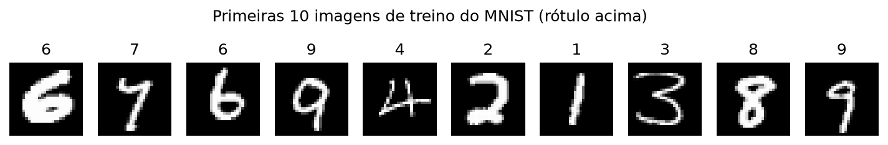
/// caption
**Figura A1** — Primeiras 10 imagens do conjunto de treino, desachatadas de volta para $28 \times 28$, com o
rótulo acima de cada uma.
///

### B — Build the model

!!! question "Enunciado"

    | Parte | Camadas |
    |---|---|
    | Encoder | $784 \to 512 \to 256$, ReLU depois de cada |
    | Heads | duas lineares $256 \to d$: uma para $\mu$, outra para $\log \sigma^2$ |
    | Decoder | $d \to 256 \to 512 \to 784$, ReLU nas ocultas, sigmoide na saída |

    com dimensão latente $d = 16$. A loss por imagem, somada nos pixels e nas dimensões
    latentes:

    $$
    L = -\sum_{j=1}^{784}\Big[x_j \log \hat{x}_j + (1-x_j)\log(1-\hat{x}_j)\Big]
    + \frac{1}{2}\sum_{i=1}^{d}\Big(\mu_i^2 + \sigma_i^2 - 1 - \log\sigma_i^2\Big)
    $$

    com $\mathbf{z} = \mu + \sigma \odot \varepsilon$,
    $\varepsilon \sim \mathcal{N}(0, I)$, média sobre as imagens do batch.

A classe `VAE` recebe `d` como parâmetro, para ser reaproveitada no Exercise 2. O caminho
completo de uma imagem pelo modelo, com $d = 16$:

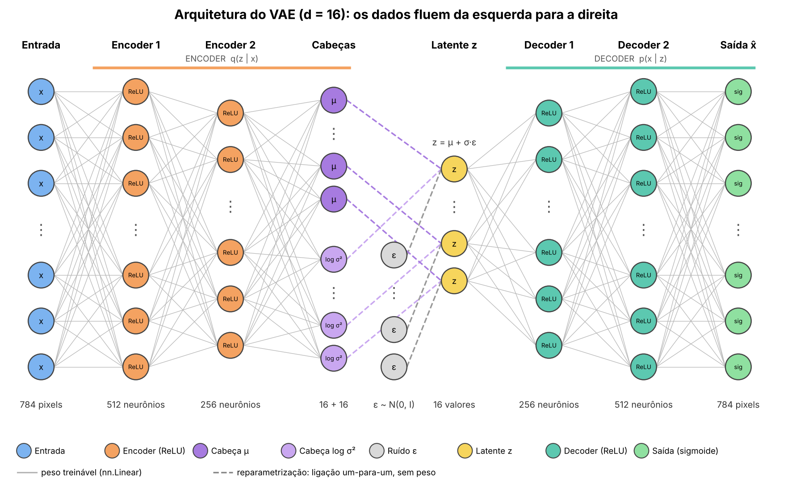
/// caption
**Figura A2** — Arquitetura do VAE com $d = 16$. Cada coluna é uma camada; só alguns neurônios estão
desenhados ("⋮" no meio) e o tamanho real aparece embaixo. As linhas cinza contínuas são os
pesos treináveis das camadas `nn.Linear`; as tracejadas são a reparametrização, em que cada
$z_i$ depende só de $\mu_i$, $\log\sigma_i^2$ e $\varepsilon_i$, sem pesos. Gerada por
`arch_diagram.py`.
///

Nos slides abaixo, cada etapa aparece no mesmo formato: onde ela fica na arquitetura (a
parte acesa do grafo), o que ela produz para a primeira imagem de teste (índice 0, um 7)
passando pelo modelo $d = 16$ já treinado, o que acontece ali, a equação da camada e o
código que a implementa. Use os botões ◀ ▶, os pontos ou as setas do teclado para navegar. As figuras são geradas por
`arch_diagram.py` e `forward_steps.py`.

<div class="slides" markdown>

<div class="slide" markdown>

<p class="slide-titulo">Passo 1 de 7 · Entrada</p>

<p class="slide-rotulo">Onde estamos</p>

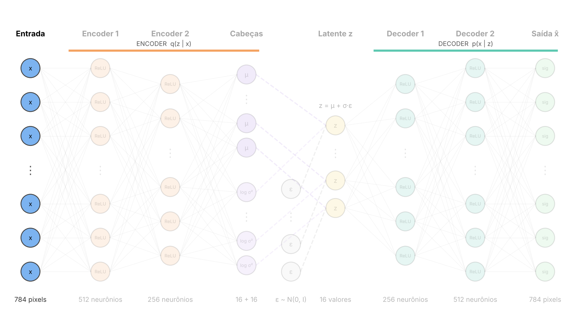{ .slide-arq }
/// caption
**Figura A3.1 a** — Arquitetura, com a entrada em destaque.
///

<p class="slide-rotulo">No exemplo</p>

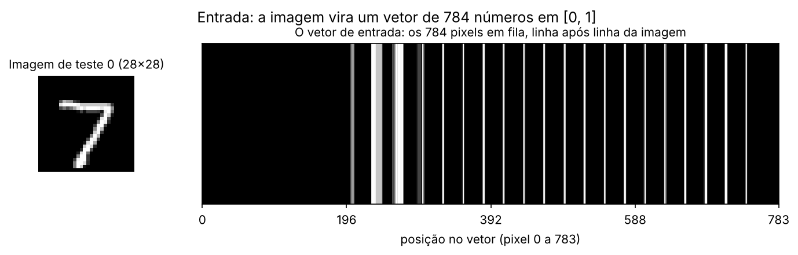{ .slide-ex }
/// caption
**Figura A3.1 b** — Vetor de entrada da imagem de teste 0 (um 7).
///

<p class="slide-rotulo">O que acontece</p>

A imagem de $28 \times 28$ é achatada num **vetor de 784 números**, linha após linha: as faixas
claras do vetor são os trechos de cada linha por onde o traço do 7 passa. Para a rede, a
entrada é só essa fila de 784 **valores entre 0 e 1**.

<p class="slide-rotulo">Equação</p>

$$
\mathbf{x} = \big(x_1, x_2, \dots, x_{784}\big) \in [0, 1]^{784},
\qquad x_{28\,(r-1) + c} = \text{pixel na linha } r \text{ e coluna } c
$$

<p class="slide-rotulo">Código</p>

```python
x = X_test[0:1]          # (1, 784), já achatado em to_tensors
```

</div>

<div class="slide" markdown>

<p class="slide-titulo">Passo 2 de 7 · Encoder</p>

<p class="slide-rotulo">Onde estamos</p>

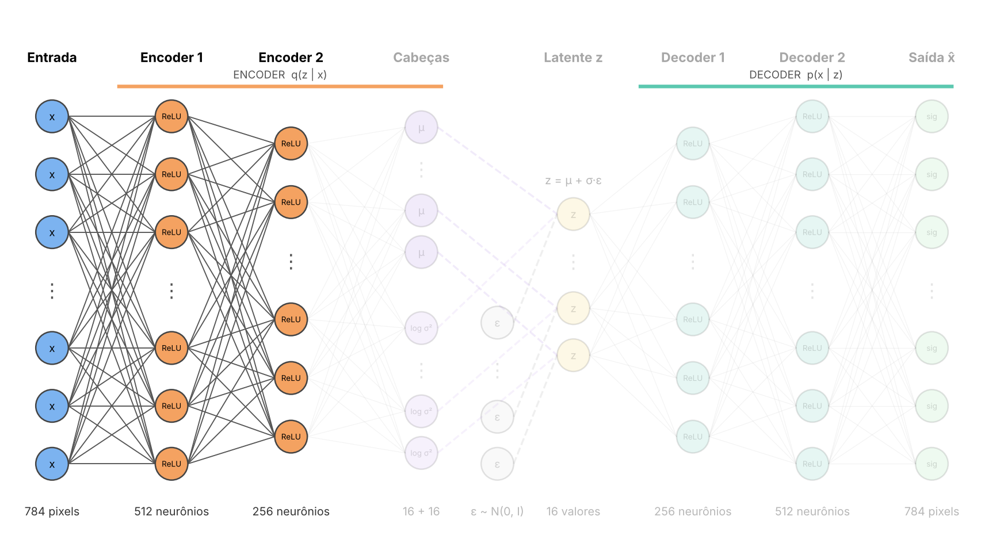{ .slide-arq }
/// caption
**Figura A3.2 a** — Arquitetura, com o encoder em destaque.
///

<p class="slide-rotulo">No exemplo</p>

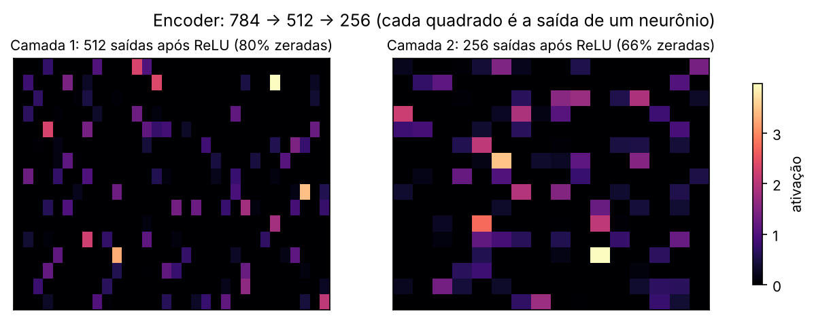{ .slide-ex }
/// caption
**Figura A3.2 b** — Saídas das duas camadas do encoder após a ReLU, para a imagem de teste 0.
///

<p class="slide-rotulo">O que acontece</p>

Todas as camadas do modelo são `nn.Linear`: cada neurônio recebe **todas as saídas da camada
anterior**, multiplica cada uma por um **peso**, soma e acrescenta um **viés**. Em `nn.Linear(a, b)`,
`a` é o **número de entradas** de cada neurônio e `b` é o **número de neurônios**, ou seja, de
saídas. O `nn.Sequential` aplica as camadas uma depois da outra.

A primeira camada transforma os 784 pixels em 512 valores, e a segunda, em 256; **a ReLU zera
os resultados negativos**. Na Figura A3.2 b, os valores estão desenhados em grade só para caber na
tela. Boa parte dos neurônios fica zerada para esta imagem: **cada um "acende"** só para os
padrões que aprendeu a detectar.

<p class="slide-rotulo">Equação</p>

$$
\begin{aligned}
\mathbf{h}_1 &= \operatorname{ReLU}\big(W_1\,\mathbf{x} + \mathbf{b}_1\big),
  & W_1 &\in \mathbb{R}^{512 \times 784},\ \mathbf{b}_1 \in \mathbb{R}^{512} \\
\mathbf{h}_2 &= \operatorname{ReLU}\big(W_2\,\mathbf{h}_1 + \mathbf{b}_2\big),
  & W_2 &\in \mathbb{R}^{256 \times 512},\ \mathbf{b}_2 \in \mathbb{R}^{256}
\end{aligned}
$$

onde $\mathbf{h}_1$ são as **512 saídas da primeira camada** do encoder e $\mathbf{h}_2$ as
**256 saídas da segunda** (o `h` do código), $W$ são as matrizes de pesos e $\mathbf{b}$ os
vetores de viés. Um neurônio $k$ da primeira camada, com $\operatorname{ReLU}(a) = \max(0, a)$:

$$
h_{1,k} = \max\Big(0,\ \sum_{j=1}^{784} W_{1,kj}\, x_j + b_{1,k}\Big)
$$

<p class="slide-rotulo">Código</p>

```python
# no __init__
self.encoder = nn.Sequential(
    nn.Linear(784, 512), nn.ReLU(),
    nn.Linear(512, 256), nn.ReLU(),
)

# no encode
h = self.encoder(x)              # 784 -> 512 -> 256
```

</div>

<div class="slide" markdown>

<p class="slide-titulo">Passo 3 de 7 · Cabeças</p>

<p class="slide-rotulo">Onde estamos</p>

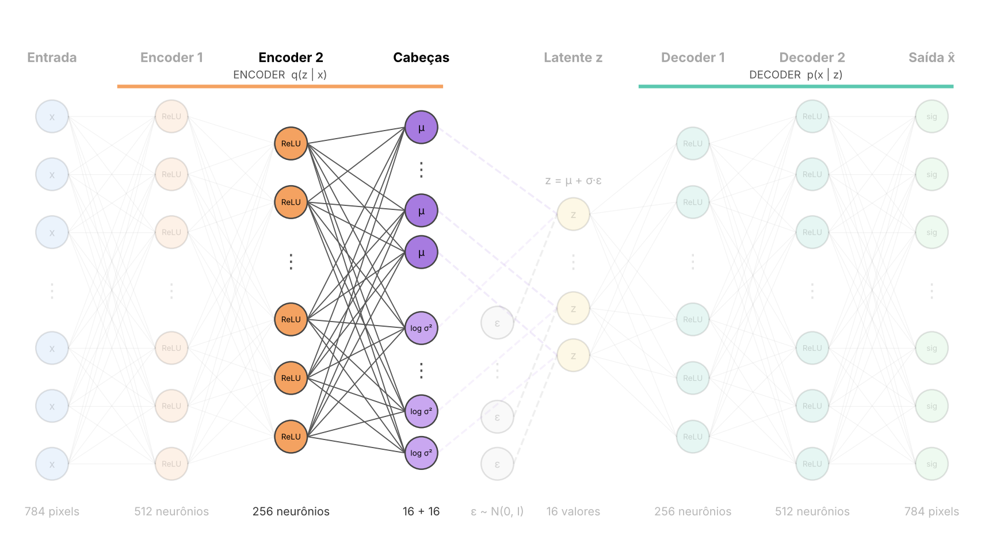{ .slide-arq }
/// caption
**Figura A3.3 a** — Arquitetura, com as cabeças em destaque.
///

<p class="slide-rotulo">No exemplo</p>

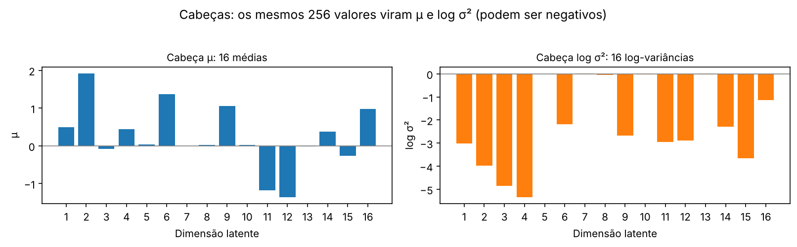{ .slide-ex }
/// caption
**Figura A3.3 b** — Saídas dos 16 + 16 neurônios das cabeças $\mu$ e $\log\sigma^2$, para a imagem de teste 0.
///

<p class="slide-rotulo">O que acontece</p>

**Os mesmos 256 valores** entram, em paralelo, nas duas cabeças, cada uma com 16 neurônios e os
próprios pesos. As cabeças **não calculam a média e a variância dos 256 valores**: elas aprendem
a produzir, para cada imagem, **os parâmetros de uma distribuição** no espaço latente — o centro
$\mu$ e a log-variância $\log\sigma^2$ de cada dimensão. O que faz uma saída ser "a média" e
a outra "a log-variância" é **onde cada uma é usada**, na reparametrização e na KL.

As cabeças **não têm ReLU** porque $\mu$ e $\log\sigma^2$ precisam poder ser negativos. A rede
prevê $\log\sigma^2$ em vez de $\sigma$ porque o log **pode assumir qualquer valor real**,
enquanto $\sigma$ precisa ser positivo. Na Figura A3.3 b, um $\log\sigma^2$ muito negativo é um
$\sigma$ pequeno (o modelo tem certeza de onde aquela dimensão deve ficar), e
$\log\sigma^2 \approx 0$ com $\mu \approx 0$ é **uma dimensão que o modelo não usa**.

<p class="slide-rotulo">Equação</p>

$$
\begin{aligned}
\mu &= W_\mu\,\mathbf{h}_2 + \mathbf{b}_\mu,
  & W_\mu &\in \mathbb{R}^{d \times 256} \\
\log\sigma^2 &= W_\sigma\,\mathbf{h}_2 + \mathbf{b}_\sigma,
  & W_\sigma &\in \mathbb{R}^{d \times 256}
\end{aligned}
$$

As duas recebem o mesmo $\mathbf{h}_2$ e não têm ativação, por isso as saídas podem ser
qualquer número real.

<p class="slide-rotulo">Código</p>

```python
# no __init__
self.head_mu = nn.Linear(256, d)
self.head_logvar = nn.Linear(256, d)

# no encode
mu = self.head_mu(h)             # 256 -> d
logvar = self.head_logvar(h)     # 256 -> d
return mu, logvar
```

</div>

<div class="slide" markdown>

<p class="slide-titulo">Passo 4 de 7 · Reparametrização</p>

<p class="slide-rotulo">Onde estamos</p>

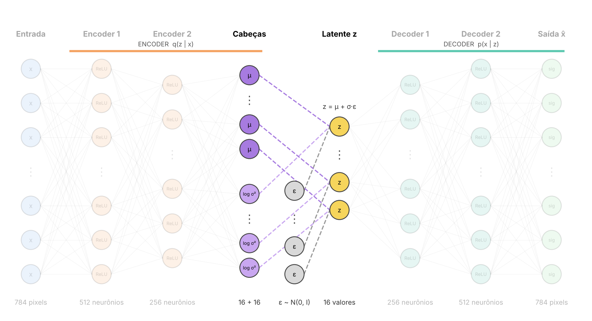{ .slide-arq }
/// caption
**Figura A3.4 a** — Arquitetura, com a reparametrização em destaque.
///

<p class="slide-rotulo">No exemplo</p>

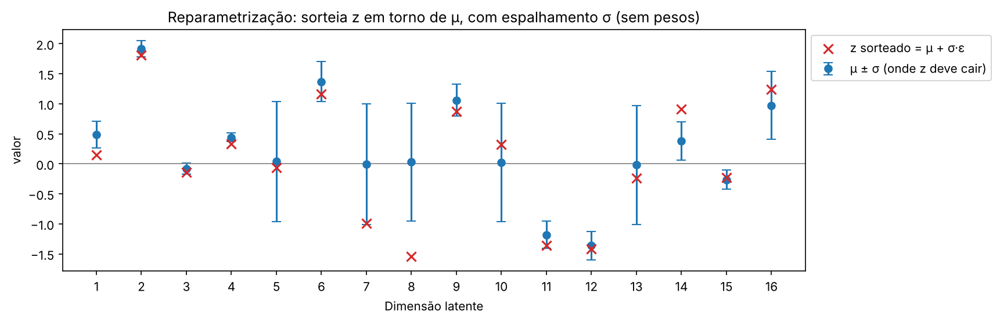{ .slide-ex }
/// caption
**Figura A3.4 b** — $\mu \pm \sigma$ e o $z_i$ sorteado em cada uma das 16 dimensões.
///

<p class="slide-rotulo">O que acontece</p>

As cabeças não entregam um código, entregam uma **distribuição** por dimensão: "o código
desta imagem está em torno de $\mu_i$, com espalhamento $\sigma_i$". O decoder, porém,
precisa receber números concretos. A reparametrização **sorteia um valor $z_i$ para cada uma
das 16 dimensões**, e os 16 valores juntos, de $z_1$ a $z_{16}$, são as coordenadas de **um
único ponto** $\mathbf{z}$ no espaço latente.

Toda a aleatoriedade fica no $\varepsilon \sim \mathcal{N}(0, I)$, que **não depende de
nenhum peso**; por isso $\mathbf{z}$ é uma conta comum e **o gradiente da reconstrução chega
às cabeças e ao encoder**.

Esta etapa **não tem neurônios nem pesos**: no grafo, cada $z_i$ se liga só ao seu $\mu_i$,
ao seu $\log\sigma_i^2$ e ao seu $\varepsilon_i$.

Na Figura A3.4 b, o ponto azul é $\mu$, a barra vai de $\mu - \sigma$ a $\mu + \sigma$ e o
$\times$ vermelho é o $z_i$ sorteado; os 16 $\times$ juntos são o ponto $\mathbf{z}$. Nas
dimensões usadas, a barra é curta e $z_i$ cai quase em cima de $\mu_i$. Nas não usadas,
$\mu \approx 0$ e $\sigma \approx 1$: o código ali é só o ruído do prior, e **o decoder
aprende a ignorá-lo**.

<p class="slide-rotulo">Equação</p>

$$
\sigma = \exp\big(\tfrac{1}{2}\log\sigma^2\big), \qquad
\varepsilon \sim \mathcal{N}(\mathbf{0}, I), \qquad
\mathbf{z} = \mu + \sigma \odot \varepsilon
$$

Dimensão por dimensão, sem nenhum peso (é a ligação um-para-um do grafo):

$$
z_i = \mu_i + \sigma_i\,\varepsilon_i, \qquad i = 1, \dots, d
$$

<p class="slide-rotulo">Código</p>

```python
def reparameterize(self, mu, logvar):
    std = torch.exp(0.5 * logvar)    # sigma = exp(½ log sigma²)
    eps = torch.randn_like(std)      # epsilon ~ N(0, I), sorteio novo a cada passada
    z = mu + std * eps
    return z
```

</div>

<div class="slide" markdown>

<p class="slide-titulo">Passo 5 de 7 · Decoder</p>

<p class="slide-rotulo">Onde estamos</p>

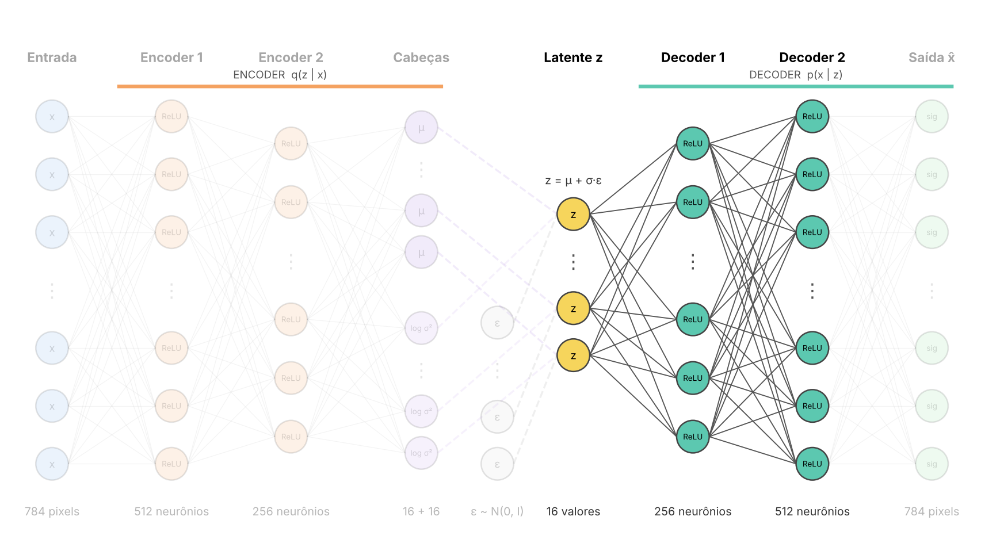{ .slide-arq }
/// caption
**Figura A3.5 a** — Arquitetura, com o decoder em destaque.
///

<p class="slide-rotulo">No exemplo</p>

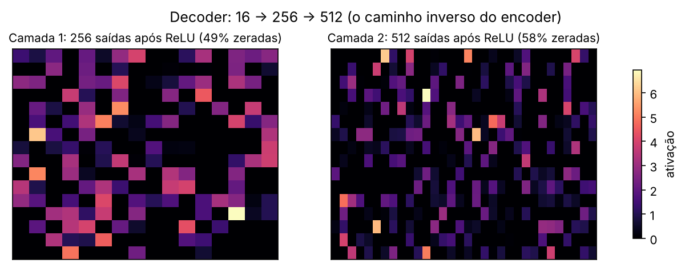{ .slide-ex }
/// caption
**Figura A3.5 b** — Saídas das duas camadas ocultas do decoder após a ReLU, para a imagem de teste 0.
///

<p class="slide-rotulo">O que acontece</p>

O decoder faz o **caminho inverso do encoder**: os 16 valores de $\mathbf{z}$ viram 256 e depois
512, com ReLU depois de cada camada. Esses valores **ainda não são uma imagem**; são a
"descrição" expandida que a última camada transforma em pixels.

<p class="slide-rotulo">Equação</p>

$$
\begin{aligned}
\mathbf{g}_1 &= \operatorname{ReLU}\big(W_3\,\mathbf{z} + \mathbf{b}_3\big),
  & W_3 &\in \mathbb{R}^{256 \times d} \\
\mathbf{g}_2 &= \operatorname{ReLU}\big(W_4\,\mathbf{g}_1 + \mathbf{b}_4\big),
  & W_4 &\in \mathbb{R}^{512 \times 256}
\end{aligned}
$$

onde $\mathbf{g}_1$ são as **256 saídas da primeira camada** do decoder e $\mathbf{g}_2$ as
**512 saídas da segunda**. É a mesma conta do encoder, com outros pesos: a letra muda
($\mathbf{h}$ no encoder, $\mathbf{g}$ no decoder) só para separar as duas metades.

<p class="slide-rotulo">Código</p>

```python
# no __init__
self.decoder = nn.Sequential(
    nn.Linear(d, 256), nn.ReLU(),
    nn.Linear(256, 512), nn.ReLU(),
    nn.Linear(512, 784), nn.Sigmoid(),   # a última camada é o passo 6
)
```

</div>

<div class="slide" markdown>

<p class="slide-titulo">Passo 6 de 7 · Saída</p>

<p class="slide-rotulo">Onde estamos</p>

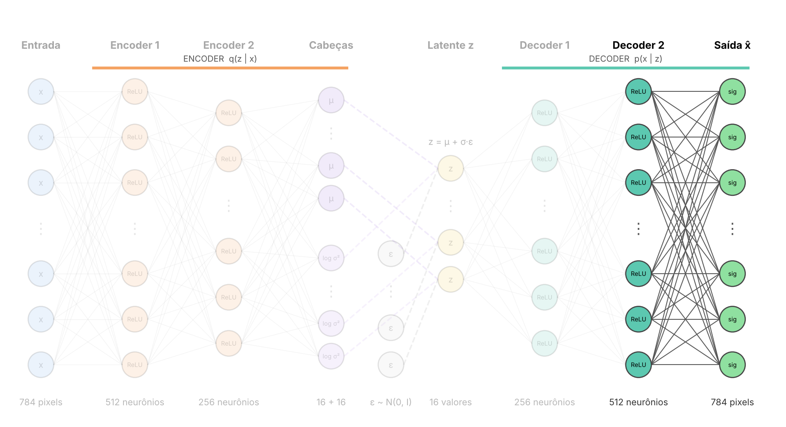{ .slide-arq }
/// caption
**Figura A3.6 a** — Arquitetura, com a saída em destaque.
///

<p class="slide-rotulo">No exemplo</p>

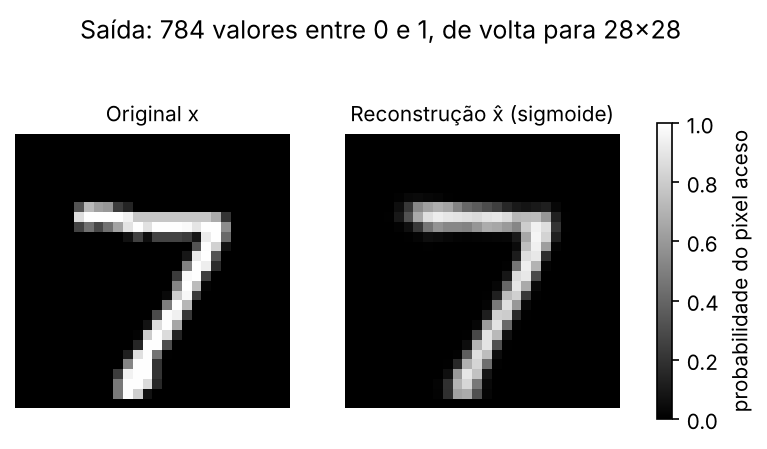{ .slide-ex }
/// caption
**Figura A3.6 b** — Imagem original e reconstrução $\hat{x}$ (saída da sigmoide).
///

<p class="slide-rotulo">O que acontece</p>

A última camada tem 784 neurônios, **um por pixel**, e a sigmoide deixa cada valor entre 0 e 1:
**a probabilidade de aquele pixel estar aceso**. Desachatando de volta para $28 \times 28$,
aparece a reconstrução, que mantém o 7 com as bordas mais suaves que o original. O
`forward` **liga todas as etapas**, da imagem até a reconstrução.

<p class="slide-rotulo">Equação</p>

$$
\hat{\mathbf{x}} = \operatorname{sigmoide}\big(W_5\,\mathbf{g}_2 + \mathbf{b}_5\big),
\qquad W_5 \in \mathbb{R}^{784 \times 512}
$$

onde $\mathbf{g}_2$ são as 512 saídas do passo 5 e $\hat{\mathbf{x}}$ os **784 pixels
reconstruídos**. A **sigmoide** é aplicada a cada um dos 784 valores separadamente:

$$
\operatorname{sigmoide}(a) = \frac{1}{1 + e^{-a}} \in (0, 1)
$$

Ela leva qualquer número real para o intervalo entre 0 e 1: $a$ muito negativo dá quase 0
(pixel apagado), $a = 0$ dá $0.5$ e $a$ muito positivo dá quase 1 (pixel aceso). Para o
pixel $j$:

$$
\hat{x}_j = \frac{1}{1 + e^{-\left(\sum_{k=1}^{512} W_{5,jk}\, g_{2,k} + b_{5,j}\right)}}
$$

<p class="slide-rotulo">Código</p>

```python
def forward(self, x):
    mu, logvar = self.encode(x)
    z = self.reparameterize(mu, logvar)
    x_hat = self.decoder(z)          # d -> 256 -> 512 -> 784, cada pixel em (0, 1)
    return x_hat, mu, logvar
```

</div>

<div class="slide" markdown>

<p class="slide-titulo">Passo 7 de 7 · Loss</p>

<p class="slide-rotulo">Onde estamos</p>

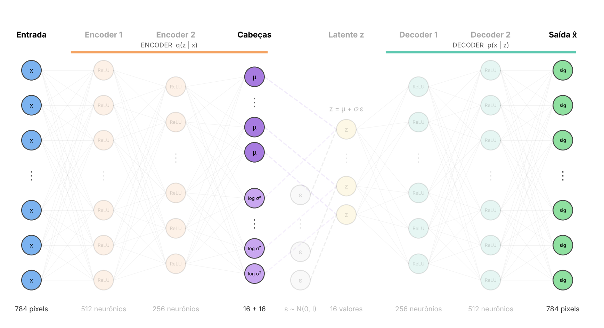{ .slide-arq }
/// caption
**Figura A3.7 a** — Arquitetura, com o que a loss usa em destaque ($x$, $\hat{x}$, $\mu$ e $\log\sigma^2$).
///

<p class="slide-rotulo">No exemplo</p>

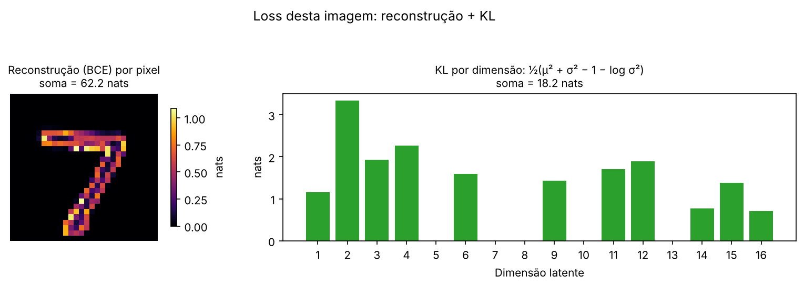{ .slide-ex }
/// caption
**Figura A3.7 b** — Reconstrução (BCE) por pixel e KL por dimensão, para a imagem de teste 0.
///

<p class="slide-rotulo">O que acontece</p>

A loss olha para **quatro coisas**, as acesas no grafo: a entrada $x$ e a saída $\hat{x}$ para
a reconstrução, e $\mu$ e $\log\sigma^2$ para a KL. A função devolve os **dois termos
separados**, em nats por imagem:

- A reconstrução usa `reduction="sum"` e divide pelo tamanho do batch. Com
  `reduction="mean"`, ela seria dividida também pelos 784 pixels e ficaria **784 vezes menor**
  em relação à KL.
- A KL é a **forma fechada** do enunciado escrita à mão: `mu.pow(2)` é $\mu^2$, `logvar.exp()`
  é $\sigma^2$ e `logvar` é $\log\sigma^2$.

Na Figura A3.7 b, a BCE de cada pixel **se concentra nas bordas do traço**, onde o modelo está em
dúvida; o fundo, que ele acerta com confiança, custa quase nada. As dimensões usadas pagam
entre 1 e 3 nats de KL para guardar informação desta imagem, e as não usadas **pagam zero**.

Como verificação, com o modelo ainda sem treino e 4 imagens de treino, a reconstrução foi
**544.72 nats** e a KL **0.04 nats**. A reconstrução é próxima de
$784 \cdot \ln 2 \approx 543$, o valor de um modelo que prevê 0.5 em todos os pixels, e a KL
é pequena porque no início $\mu \approx 0$ e $\sigma \approx 1$.

<p class="slide-rotulo">Equação</p>

Para uma imagem, os dois termos (em nats):

$$
\underbrace{-\sum_{j=1}^{784}\Big[x_j \log \hat{x}_j + (1-x_j)\log(1-\hat{x}_j)\Big]}_{\text{reconstrução (BCE)}}
\qquad
\underbrace{\frac{1}{2}\sum_{i=1}^{d}\Big(\mu_i^2 + \sigma_i^2 - 1 - \log\sigma_i^2\Big)}_{\text{KL}}
$$

e a loss de um batch de $B$ imagens, com $\beta = 1$, é a média da soma dos dois:

$$
\mathcal{L} = \frac{1}{B}\sum_{b=1}^{B}\Big[\text{reconstrução}^{(b)} + \beta\,\text{KL}^{(b)}\Big]
$$

<p class="slide-rotulo">Código</p>

```python
def vae_loss(x_hat, x, mu, logvar):
    batch = x.shape[0]
    recon = F.binary_cross_entropy(x_hat, x, reduction="sum") / batch
    kl = 0.5 * torch.sum(mu.pow(2) + logvar.exp() - 1 - logvar) / batch
    return recon, kl
```

</div>

</div>

??? example "Ver o código que gera as figuras do passo a passo"

    ```{ .python .copy .select linenums='1' title="docs/exercises/vae/code/forward_steps.py" }
    --8<-- "docs/exercises/vae/code/forward_steps.py"
    ```

### C — Train

!!! question "Enunciado"

    Treine com Adam, taxa de aprendizado $10^{-3}$, batch 128, por 20 épocas. Ao fim de cada
    época, registre a reconstrução e a KL no treino (média da época) e na validação.
    Reporte a reconstrução, a KL e a soma (o ELBO negativo) no teste, em nats por imagem.
    Produza a Figura 1: dois painéis, reconstrução por época e KL por época, cada um com
    as curvas de treino e de validação.

A função `train_vae(d)` fixa `torch.manual_seed(42)`, cria o modelo e o Adam e, em cada
época:

1. embaralha as imagens de treino;
2. para cada batch de 128: forward → `vae_loss` → `loss = recon + kl` → `backward()` →
   `step()`;
3. guarda a média da época de reconstrução e KL no treino;
4. calcula reconstrução e KL na validação com `evaluate`, que roda sem gradiente
   (`@torch.no_grad()`).

??? example "Ver o código do laço de treino (`train_vae`)"

    O laço de treino, com as quatro fases de cada batch (forward, loss, `backward()` e
    `step()`):

    ```python
    def train_vae(d, epochs=20, batch_size=128, lr=1e-3):
        """Treina um VAE com latente de dimensão d e devolve o modelo e o histórico por época."""
        torch.manual_seed(42)  # semente antes de construir o modelo (regra técnica)
        model = VAE(d)
        opt = torch.optim.Adam(model.parameters(), lr=lr)
        hist = {"train_recon": [], "train_kl": [], "val_recon": [], "val_kl": []}

        for epoch in range(epochs):
            model.train()
            perm = torch.randperm(len(X_train))  # embaralha o treino a cada época
            recon_total, kl_total = 0.0, 0.0
            for i in range(0, len(X_train), batch_size):
                x = X_train[perm[i:i + batch_size]]
                x_hat, mu, logvar = model(x)              # forward
                recon, kl = vae_loss(x_hat, x, mu, logvar)
                loss = recon + kl                         # o que o otimizador minimiza
                opt.zero_grad()
                loss.backward()                           # gradiente de todos os pesos
                opt.step()                                # ajusta os pesos
                recon_total += recon.item() * len(x)
                kl_total += kl.item() * len(x)

            # treino: média da época; validação: avaliada no fim da época
            hist["train_recon"].append(recon_total / len(X_train))
            hist["train_kl"].append(kl_total / len(X_train))
            val_recon, val_kl = evaluate(model, X_val)
            hist["val_recon"].append(val_recon)
            hist["val_kl"].append(val_kl)
            print(f"d={d} época {epoch + 1:2d}: treino recon {hist['train_recon'][-1]:.2f} "
                  f"KL {hist['train_kl'][-1]:.2f} | val recon {val_recon:.2f} KL {val_kl:.2f}")

        return model, hist
    ```

??? example "Ver o código da avaliação (`evaluate`)"

    A avaliação calcula os dois termos num conjunto inteiro sem mexer nos pesos: o
    `@torch.no_grad()` desliga o gradiente e não há `backward()` nem `step()`.

    ```python
    @torch.no_grad()  # só avalia: não calcula gradiente nem mexe nos pesos
    def evaluate(model, X, batch_size=1000):
        """Reconstrução e KL médias (nats por imagem) de um conjunto inteiro."""
        model.eval()
        recon_total, kl_total = 0.0, 0.0
        for i in range(0, len(X), batch_size):
            x = X[i:i + batch_size]
            x_hat, mu, logvar = model(x)
            recon, kl = vae_loss(x_hat, x, mu, logvar)
            recon_total += recon.item() * len(x)  # volta à soma do batch, para fazer a média no fim
            kl_total += kl.item() * len(x)
        return recon_total / len(X), kl_total / len(X)
    ```

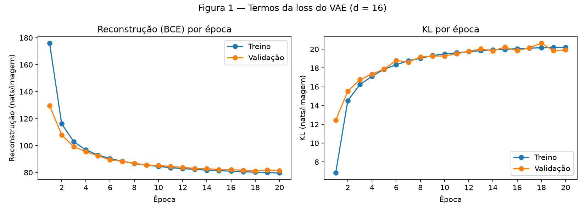
/// caption
**Figura 1** — Reconstrução (esquerda) e KL (direita) por época, no treino e na validação,
para $d = 16$. A reconstrução cai de 176 para 80 nats, enquanto a KL sobe de 7 para 20.
///

Treino e validação ficam praticamente sobrepostos, então o modelo não está decorando o
treino. Na primeira época, a curva de treino fica acima da validação na reconstrução e
abaixo na KL porque é a média de uma época em que o modelo começou sem treino, enquanto a
validação é medida já no fim da época.

O treino levou cerca de 3 minutos na CPU.

| Época | Treino: reconstrução | Treino: KL | Validação: reconstrução | Validação: KL |
|---:|---:|---:|---:|---:|
| 1 | 175.96 | 6.83 | 129.69 | 12.45 |
| 5 | 93.00 | 17.86 | 92.50 | 17.89 |
| 10 | 84.54 | 19.49 | 85.21 | 19.28 |
| 15 | 81.37 | 19.98 | 82.14 | 20.22 |
| 20 | 79.71 | 20.20 | 81.46 | 19.92 |

**Números finais no teste ($d = 16$):**

| Termo | nats por imagem |
|---|---:|
| Reconstrução | **80.82** |
| KL | **19.96** |
| ELBO negativo (soma) | **100.78** |

Os valores batem com a referência do enunciado (cerca de 81 de reconstrução e 20 de KL).

### D — Reconstructions and samples

!!! question "Enunciado"

    Produza a Figura 2: a primeira imagem de teste de cada dígito 0–9 na linha de cima e a
    sua reconstrução na linha de baixo, decodificando $\mu$ (sem sortear
    $\mathbf{z}$). Produza a Figura 3: uma grade $8 \times 8$ de imagens decodificadas de
    $\mathbf{z} \sim \mathcal{N}(0, I)$, sorteadas depois de `torch.manual_seed(0)`.

Na Figura 2, as primeiras imagens de teste de cada dígito, de 0 a 9, estão nos índices
**3, 2, 1, 18, 4, 8, 11, 0, 61 e 7**. Cada imagem passa pelo `encode` e o decoder recebe
diretamente o $\mu$, sem passar pelo `reparameterize`.

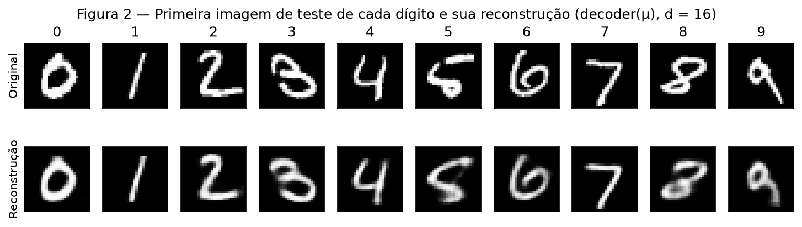
/// caption
**Figura 2** — Primeira imagem de teste de cada dígito (em cima) e a reconstrução obtida
decodificando $\mu$ (embaixo), $d = 16$.
///

Na Figura 3, o encoder não é usado: depois de `torch.manual_seed(0)`, 64 vetores
$\mathbf{z}$ de 16 dimensões são sorteados com `torch.randn(64, 16)` e passados direto
pelo decoder.

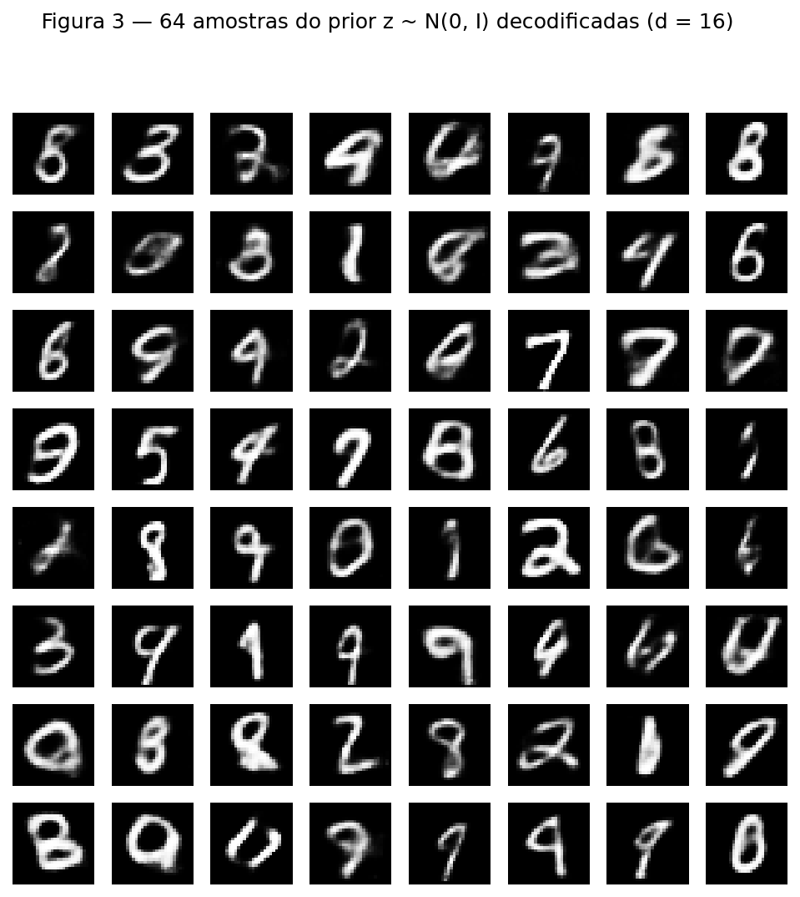
/// caption
**Figura 3** — 64 imagens geradas decodificando $\mathbf{z} \sim \mathcal{N}(0, I)$
($d = 16$, `torch.manual_seed(0)`).
///

As reconstruções da Figura 2 preservam o dígito e o formato geral, mas são mais borradas que
os originais, principalmente nos dígitos com traço mais irregular, como o 5 e o 8. Na
Figura 3, a maioria das amostras é um dígito reconhecível, mas há imagens mais borradas e
algumas que não são dígito nenhum.

#### Bônus: onde o encoder coloca cada dígito

O $\mu$ de cada imagem tem 16 números, então o espaço latente de $d = 16$ não pode ser
desenhado diretamente. Para ver como os dígitos se distribuem nele, os $\mu$ das 10 000
imagens de teste foram projetados em 2D com t-SNE, do scikit-learn, e cada ponto foi
colorido pelo dígito.

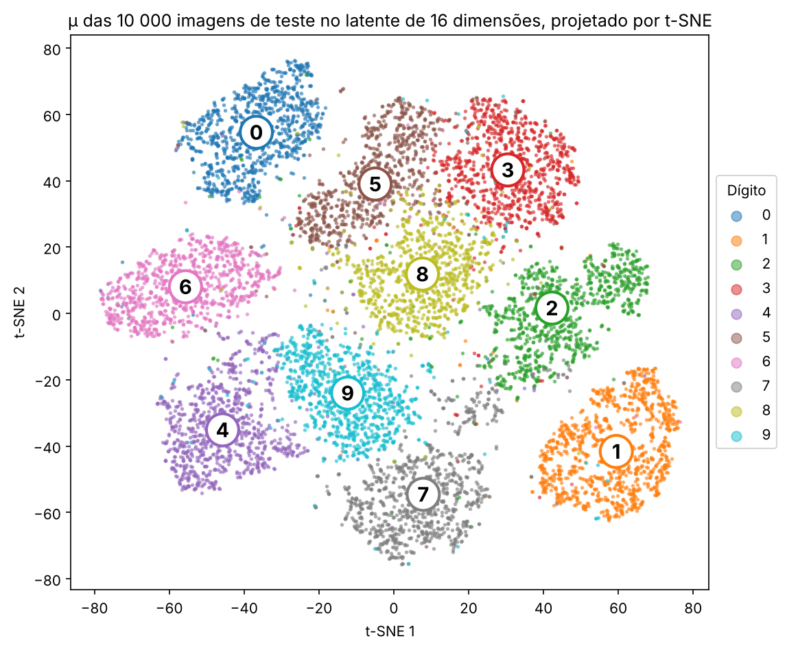
/// caption
**Figura A4** — $\mu$ das 10 000 imagens de teste no latente de $d = 16$, projetados em 2D por
t-SNE e coloridos pelo dígito. O número em cada nuvem marca a mediana dos seus pontos.
///

Cada dígito forma a **sua própria nuvem**, e poucas imagens caem na nuvem de outro dígito:
mesmo sem nunca ver um rótulo, o encoder aprendeu a separar os dígitos. As nuvens vizinhas
são as dos dígitos de **formato parecido**: 3, 5 e 8 ficam encostados, assim como 4, 9 e 7.

O t-SNE preserva **quem é vizinho de quem** no espaço de 16 dimensões, mas o tamanho das
nuvens e a distância entre elas no desenho não têm significado. Ele foi usado no lugar do
PCA porque, como a KL espalha a informação por igual entre as dimensões usadas, as duas
direções principais do PCA explicam só cerca de 22% da variação dos $\mu$, e os dígitos
apareciam misturados.

??? example "Ver o código do bônus"

    ```{ .python .copy .select linenums='1' title="docs/exercises/vae/code/bonus_encodings.py" }
    --8<-- "docs/exercises/vae/code/bonus_encodings.py"
    ```

### E — Analysis

!!! question "Enunciado"

    1. Figura 1: a KL sobe nas primeiras épocas enquanto a loss total cai. Por que o
       otimizador escolheria pagar mais KL?
    2. A Figura 3 parece pior que a Figura 2: dígitos mais borrados, alguns que não são
       dígito nenhum. Dê duas razões separadas, uma sobre onde as amostras do prior caem no
       espaço latente e outra sobre o que o decoder produz para um dado $\mathbf{z}$.
    3. Por que decodificar $\mu$, e não um $\mathbf{z}$ sorteado, na Figura 2?

**1. Por que a KL sobe.** No início do treino, o encoder devolve $\mu \approx 0$ e
$\sigma \approx 1$ para qualquer imagem: o código é igual ao prior, a KL é quase zero, mas o
código não carrega nenhuma informação, e a reconstrução é péssima. Para reconstruir melhor, o
encoder precisa afastar os $\mu$ de zero (cada dígito num lugar) e encolher os $\sigma$
(códigos precisos), e é exatamente isso que a KL cobra. O otimizador aceita pagar porque só
olha a soma, e no começo a troca é muito favorável: entre as épocas 1 e 5, a KL de treino
subiu 11 nats (de 6.83 para 17.86), mas a reconstrução caiu 83 nats (de 175.96 para 93.00), e
a loss total caiu 72. A KL estabiliza perto de 20 nats quando guardar mais um detalhe no
código já custaria mais KL do que economizaria em reconstrução.

**2. Por que a Figura 3 parece pior que a Figura 2.**

- **Onde as amostras caem.** Na Figura 2, o decoder recebe o $\mu$ de uma imagem real, que cai
  numa região onde ele treinou com muitas imagens. Na Figura 3, o $\mathbf{z}$ é sorteado do
  prior sem olhar para os dados. A KL puxa os códigos para dentro do prior, mas eles não o
  cobrem por igual (o bônus da Figura A4 mostra nuvens separadas por dígito), e um
  $\mathbf{z}$ que cai entre as nuvens ou num canto pouco visitado decodifica em algo que não
  é dígito, ou numa mistura de dois.
- **O que o decoder produz.** Para um dado $\mathbf{z}$, o decoder devolve a imagem que erra
  menos em média entre todas as imagens de treino com código parecido, ou seja, a média delas.
  A média de vários dígitos nítidos, com traços em posições um pouco diferentes, é borrada. Na
  Figura 2 isso pesa pouco, porque o $\mu$ de uma imagem real é um código preciso; um
  $\mathbf{z}$ aleatório cai com mais frequência em regiões ambíguas, onde essa média mistura
  imagens bem diferentes.

**3. Por que decodificar $\mu$ na Figura 2.** A Figura 2 não gera imagens novas: ela
reconstrói imagens reais para mostrar o quanto de cada uma sobrevive à compressão em 16
números. Para isso, o decoder deve receber o melhor código que o encoder tem para a imagem, e
esse código é o $\mu$, o centro da distribuição que o encoder lhe atribuiu. Um $\mathbf{z}$
sorteado seria esse mesmo centro somado a um ruído $\sigma \odot \varepsilon$, e a figura
passaria a mudar a cada execução: um traço borrado poderia ser culpa do modelo ou apenas de um
$\varepsilon$ que caiu longe, sem como separar uma coisa da outra. O sorteio tem papel só no
treino, onde obriga o decoder a funcionar em toda a vizinhança de $\mu$ e permite que o
gradiente passe pela reparametrização; com o modelo já treinado, ele não ensina mais nada e só
acrescentaria ruído à reconstrução.

---

## Exercise 2 — A Latent Space You Can See

O Exercise 2 está em `ex2_vae.py`, que importa do Exercise 1 a classe `VAE`, `train_vae`,
`evaluate` e os dados já achatados. No `ex1_vae.py`, o treino e as figuras ficam dentro de
`if __name__ == "__main__":`, então importar o arquivo não retreina nada.

??? example "Ver o código completo do Exercise 2"

    ```{ .python .copy .select linenums='1' title="docs/exercises/vae/code/ex2_vae.py" }
    --8<-- "docs/exercises/vae/code/ex2_vae.py"
    ```

### A — Train a 2-D VAE

!!! question "Enunciado"

    Treine o mesmo modelo do Exercise 1, mudando apenas $d = 2$. Mesmos dados, semente,
    $\beta$ e orçamento de treino. Reporte a reconstrução e a KL no teste ao lado dos números
    de $d = 16$.

O modelo é o mesmo, chamado com `train_vae(d=2)`: as duas cabeças passam a ter 2 saídas e a
primeira camada do decoder, 2 entradas. Dados, `torch.manual_seed(42)`, $\beta = 1$, Adam com
$10^{-3}$, batch 128 e 20 épocas são os do Exercise 1. O script também treina de novo o
modelo $d = 16$ (usado na interpolação do item D); como `train_vae` fixa a semente antes de criar o modelo,
ele é o mesmo do Exercise 1.

**Números no teste, em nats por imagem:**

| | $d = 16$ (Exercise 1) | $d = 2$ | Diferença |
|---|---:|---:|---:|
| Reconstrução | 80.82 | **135.61** | +54.79 |
| KL | 19.96 | **6.52** | −13.44 |
| ELBO negativo | 100.78 | **142.12** | +41.34 |

Os valores de $d = 2$ ficam perto da referência do enunciado (cerca de 135 e 7). Com só duas
dimensões, o modelo paga 13 nats a menos de KL, mas a reconstrução piora 55 nats, e o saldo
é um ELBO negativo 41 nats pior. Na validação, a reconstrução de $d = 2$ terminou a época 20
em 135.75 e a KL em 6.52, sem sinal de *overfitting*.

### B — The encoded test set

!!! question "Enunciado"

    Produza a Figura 4: um gráfico de dispersão de $\mu$ para as 10 000 imagens de teste,
    colorido por dígito, com legenda.

Cada imagem de teste passa pelo `encode` do modelo $d = 2$, e o ponto desenhado é o seu
$\mu$ (sem sortear $\mathbf{z}$).

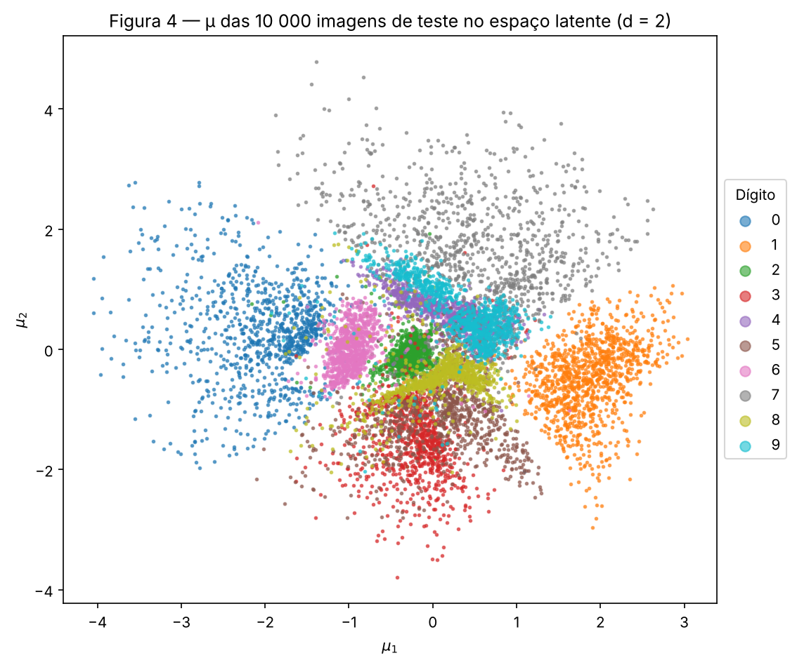
/// caption
**Figura 4** — $\mu$ das 10 000 imagens de teste no espaço latente de $d = 2$, colorido pelo
dígito.
///

Quase todos os pontos ficam a menos de 3 unidades da origem, que é onde o prior
$\mathcal{N}(0, I)$ tem quase toda a massa: é o efeito da KL. Os dígitos 0 (à esquerda), 1
(à direita) e 7 (em cima) formam grupos bem separados. No centro, vários dígitos se encostam:
4 e 9 praticamente se sobrepõem em $\mu \approx (0.2,\ 0.6)$, e 3, 5 e 8 dividem a região
de baixo. Isso é analisado no item E.

### C — The decoded plane

!!! question "Enunciado"

    Produza a Figura 5: decodifique uma grade $15 \times 15$ de pontos latentes,
    $z = \Phi^{-1}(q)$, com $q$ em 15 valores igualmente espaçados em $[0.05, 0.95]$.
    Diga em uma frase por que esse espaçamento dá a cada célula a mesma massa do prior.

Os 15 valores de $q$ vão de 0.05 a 0.95 de 0.0643 em 0.0643, e `norm.ppf` os transforma em
$z \in \{-1.64, -1.20, -0.92, \dots, 0.92, 1.20, 1.64\}$. Cada par
$(z_1, z_2)$ da grade passa pelo decoder do modelo $d = 2$; $z_2$ cresce de baixo para cima,
como nos eixos da Figura 4.

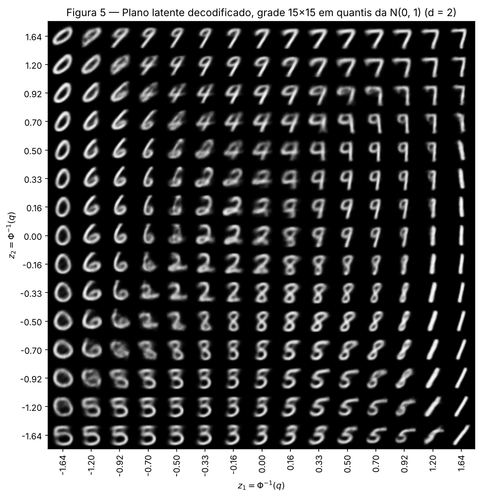
/// caption
**Figura 5** — Grade $15 \times 15$ de pontos $\mathbf{z} = (\Phi^{-1}(q_1), \Phi^{-1}(q_2))$
decodificados pelo modelo $d = 2$.
///

**Por que a grade em quantis:** como $\Phi$ é a CDF da $\mathcal{N}(0, 1)$, a probabilidade
do prior entre dois valores vizinhos da grade é
$\Phi(z_{k+1}) - \Phi(z_k) = q_{k+1} - q_k = 0.9/14 \approx 0.064$ em cada eixo, e como o
prior é o produto de duas normais independentes, cada célula da grade recebe a mesma massa,
$(0.9/14)^2 \approx 0.004$ — os pontos ficam mais juntos no centro, onde o prior tem mais
densidade, e mais espaçados nas bordas.

O plano mostra a mesma organização da Figura 4: 0 à esquerda, 1 à direita, 7 em cima e 3/5
embaixo, com 6, 2, 8, 4 e 9 no meio. Não há células vazias: todo ponto do quadrado decodifica
em algo com cara de dígito, inclusive entre os grupos.

### D — Interpolation

!!! question "Enunciado"

    Escolha duas imagens de teste de dígitos diferentes e reporte os índices. Figura 6: duas
    linhas de 10 imagens, $t$ de 0 a 1. Em cima, nos pixels: $(1-t)\,x_a + t\,x_b$. Embaixo,
    no espaço latente do modelo $d = 16$: decodifique $(1-t)\,\mu_a + t\,\mu_b$.

As imagens escolhidas são a de **índice 4** do teste (um **4**) e a de **índice 0** (um
**7**), as primeiras de cada um desses dígitos no conjunto de teste (as mesmas da Figura 2).
O $t$ percorre 10 valores igualmente espaçados de 0 a 1. A linha de baixo usa o modelo
$d = 16$: as duas imagens passam pelo `encode`, o caminho é feito entre os dois $\mu$ e cada
ponto do caminho passa pelo decoder.

```python
pixel_row = [(1 - t) * x_a + t * x_b for t in ts]              # mistura dos pixels
z_path = torch.stack([(1 - t) * mu_a + t * mu_b for t in ts])  # caminho entre os μ
latent_row = model16.decoder(z_path)
```

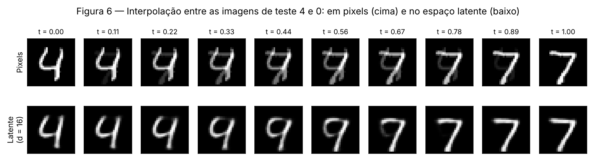
/// caption
**Figura 6** — Interpolação entre a imagem de teste 4 (um 4) e a 0 (um 7): mistura direta dos
pixels (em cima) e caminho reto entre os $\mu$ do modelo $d = 16$, decodificado (embaixo).
///

### E — Analysis

!!! question "Enunciado"

    1. Quais dígitos se sobrepõem na Figura 4? Encontre a mesma transição na Figura 5 e
       descreva as imagens do meio do caminho.
    2. $d = 2$ reconstrói claramente pior que $d = 16$. O que dois números por imagem obrigam
       o modelo a jogar fora? Use a Figura 5 como evidência.
    3. Compare as duas linhas da Figura 6. Qual delas passa por imagens que parecem dígitos e
       por que a outra não passa?

**1. Sobreposições.** Para medir a sobreposição, e não só olhar, classifiquei o $\mu$ de cada
imagem de teste pelos seus 15 vizinhos mais próximos entre os $\mu$ da validação (k-NN). No
plano de $d = 2$ ele acerta **79.8%**, contra **94.9%** usando os $\mu$ de $d = 16$. Os pares
que ele mais confunde, somando os dois sentidos, são **4/9 (548 imagens)**, **3/5 (371)**,
3/8 (176), 7/9 (164) e 5/8 (155). O par 4/9 é o pior: os centros dos dois grupos na
Figura 4 são $(0.18,\ 0.59)$ e $(0.31,\ 0.59)$, a 0.13 de distância.

Na Figura 5, essa transição aparece na faixa de cima, em $z_2 \approx 0.7$–$0.9$: andando
da esquerda para a direita, as células passam de 4 para 9 entre $z_1 \approx -0.2$ e $0$.
As imagens do meio do caminho são um 4 cujo topo vai se fechando: os dois traços de cima se
aproximam até formar a laçada do 9, e nas células de transição o topo fica borrado, meio
aberto e meio fechado, e não dá para dizer qual dos dois é. Isso faz sentido: um 4 escrito com
o topo fechado *é* quase um 9, então o modelo coloca os dois no mesmo lugar. O mesmo acontece
com 3 e 5 na faixa de baixo ($z_2 = -1.64$): o traço de cima do 5 vai se curvando até virar
a curva superior do 3, e as células do meio, em $z_1 \approx -0.5$, ficam entre os dois.

**2. O que $d = 2$ joga fora.** A KL mede quanta informação o código carrega sobre a imagem.
Com $d = 2$ ela é 6.52 nats, cerca de 3.3 por dimensão; com $d = 16$, 19.96 nats, espalhados
em 11 das 16 dimensões (as outras 5 ficam com KL abaixo de 0.1 nat, sem uso). Dois números
não têm espaço para a identidade do dígito **e** o estilo de escrita ao mesmo tempo, e o
modelo gasta quase tudo na identidade, que é o que mais reduz o erro de reconstrução. O que
vai embora é o estilo: espessura do traço, largura, inclinação, laçadas, serifas e detalhes de
cada pessoa.

A Figura 5 mostra isso de três formas:

- cada dígito aparece numa versão "média", com traço de espessura parecida em toda a grade:
  não existe um 8 grosso e um 8 fino, nem um 7 com e outro sem o tracinho no meio;
- a pouca variação de estilo que sobra é a que coincide com a direção em que o grupo se
  espalha no plano: na coluna da direita, os 1 só mudam de inclinação, de vertical (em cima) a
  bem inclinado (embaixo); e na coluna da esquerda, os 0 só mudam de largura;
- as células de transição são borradas: como o código não guarda detalhes, o decoder
  devolve a média das imagens que caem naquele ponto, e a média de um 4 e de um 9, ou de um 3
  e de um 5, é uma mancha.

E mesmo a identidade se perde em parte: as 548 imagens de 4 e 9 confundidas no item 1 são
imagens cujo código simplesmente não diz qual dos dois dígitos é. Os 55 nats a mais de reconstrução
são o preço desse estilo e dessa identidade que não cabem em dois números.

**3. As duas interpolações.** Só a linha de baixo, a do espaço latente, passa por imagens que
parecem dígitos. Na de cima, cada imagem do meio é o 4 e o 7 ao mesmo tempo, os dois
semitransparentes: em $t = 0.44$ e $t = 0.56$ aparecem as duas hastes verticais e os dois
topos, em cinza. Isso porque somar pixels não sabe nada de dígitos: a média de duas imagens
de dígito não é uma imagem de dígito.

A de baixo nunca mostra dois traços sobrepostos: todo quadro tem um traço só, com
intensidade cheia: o 4 fecha o topo e vira um **9** ($t \approx 0.33$–$0.56$), e a laçada do
9 se abre na barra do 7 ($t \geq 0.67$). Ela passa por um 9 porque, no espaço latente, o 9 fica
entre o 4 e o 7, a mesma vizinhança 4–9–7 da parte de cima das Figuras 4 e 5. Funciona
porque cada quadro é **gerado** pelo decoder a partir de um código, não misturado. E a KL é
o que garante que os códigos entre $\mu_a$ e $\mu_b$ decodifiquem em algo plausível: ela puxa
todas as gaussianas para o prior, então elas se sobrepõem e preenchem o espaço entre as
imagens de treino. Num autoencoder comum, esse caminho poderia passar por um "buraco" que o
decoder nunca viu.

---

## Results summary

| # | Quantity | Value |
|---|----------|-------|
| 1 | Ex. 1 — test reconstruction, KL and negative ELBO ($d = 16$) | reconstrução 80.82; KL 19.96; ELBO negativo 100.78 nats/imagem |
| 2 | Ex. 1 — validation KL at the first and at the last epoch | 12.45 (época 1) e 19.92 (época 20) nats/imagem |
| 3 | Ex. 2 — test reconstruction and KL ($d = 2$) | reconstrução 135.61; KL 6.52 nats/imagem (ELBO negativo 142.12) |
| 4 | Ex. 2 — the two test indices interpolated | índice 4 (dígito 4) e índice 0 (dígito 7) |
