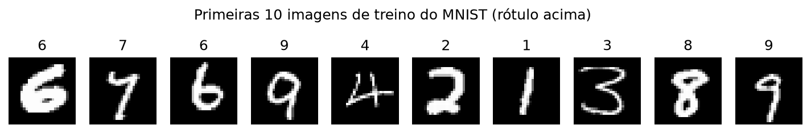
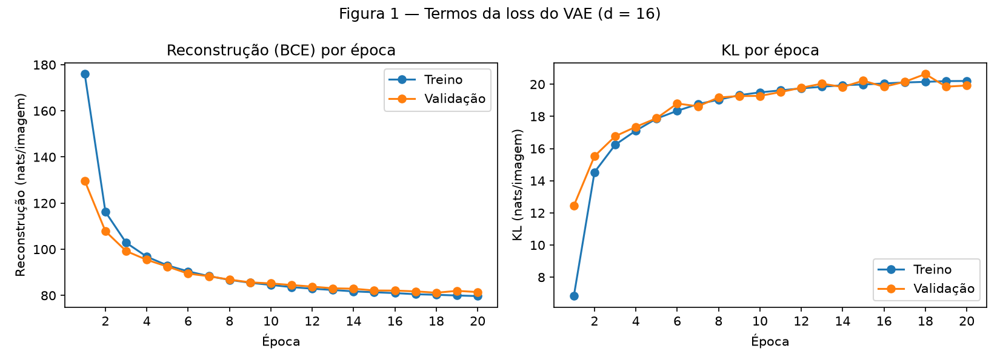
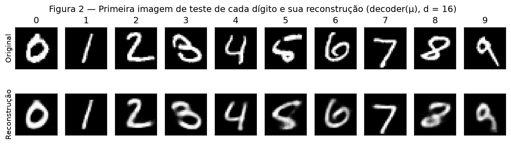
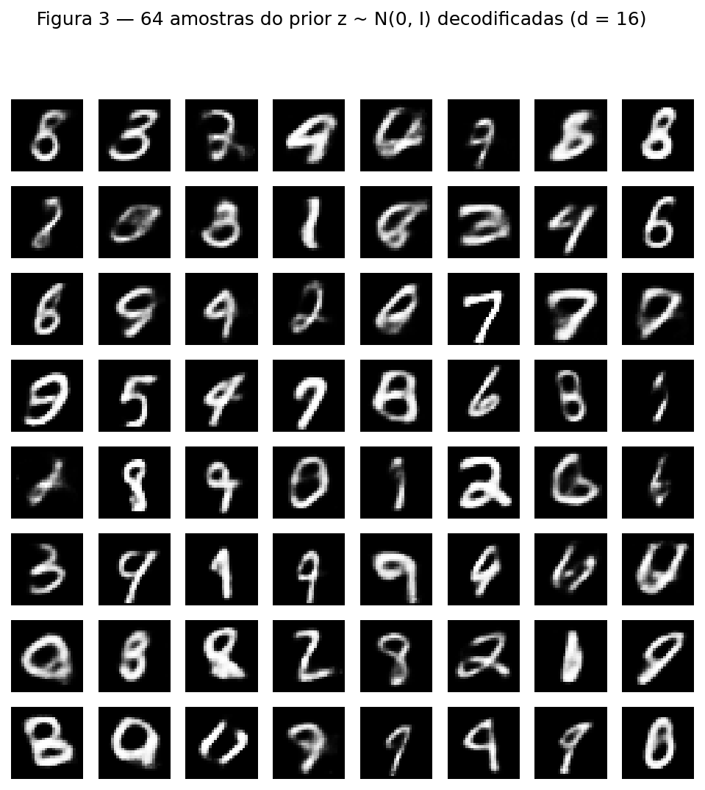

# 4. VAE

!!! abstract "Enunciado"

    [Exercises → VAE](https://insper.github.io/ann-dl/){:target='_blank'}

    O fio condutor da atividade é o cabo de guerra dentro da loss. Um VAE paga por duas
    coisas ao mesmo tempo: reconstruir a entrada e manter o espaço latente perto de um
    prior do qual se pode amostrar. Primeiro um VAE de verdade no MNIST, registrando os dois
    termos separadamente; depois um espaço latente 2-D que dá para ver.

    **Regras técnicas (valem para toda a atividade):**

    - Fixar as sementes: `torch.manual_seed(42)` antes de construir cada modelo, e o
      gerador do split dado no Exercise 1;
    - Todo gráfico deve ter título e rótulos nos eixos; todo scatter, legenda das classes;
    - Bibliotecas permitidas: `torch` e `torchvision`, `numpy`, `matplotlib`/`seaborn`,
      `scipy`/`scikit-learn` para utilidades. A reparametrização, os dois termos da loss e
      a amostragem devem ser escritos pelo aluno;
    - Reportar os dois termos da loss separadamente, em nats por imagem (somados nos 784
      pixels, média sobre as imagens);
    - O conjunto de teste só é usado para os números finais de cada modelo;
    - Todo número pedido deve aparecer no texto, não só na saída do código.

---

## Exercise 1 — A VAE on MNIST

Todo o Exercise 1 está em um único script, que treina o modelo, imprime os números e gera as
Figuras 1 a 3.

??? example "Ver o código completo do Exercise 1"

    ```{ .python .copy .select linenums='1' title="docs/exercises/vae/code/ex1_vae.py" }
    --8<-- "docs/exercises/vae/code/ex1_vae.py"
    ```

### A — Load and split the data

!!! question "Enunciado"

    Use o MNIST do `torchvision`, com pixels em $[0, 1]$, achatados em vetores de 784.
    Divida as 60 000 imagens de treino em 50 000 para treino e 10 000 para validação com
    `random_split(..., generator=torch.Generator().manual_seed(42))`. As 10 000 imagens
    oficiais de teste são o conjunto de teste.

Os dados são carregados com `transforms.ToTensor()`, que já deixa os pixels em $[0, 1]$, e o
split é exatamente o do enunciado:

```python
train_full = datasets.MNIST("data", train=True, download=True, transform=transforms.ToTensor())
test = datasets.MNIST("data", train=False, download=True, transform=transforms.ToTensor())
train, val = random_split(train_full, [50_000, 10_000],
                          generator=torch.Generator().manual_seed(42))
```

Cada imagem sai do `torchvision` com formato $(1, 28, 28)$. A função `to_tensors` empilha
todas as imagens de cada conjunto em um único tensor e achata cada uma em um vetor de 784
pixels, guardando também os rótulos:

| Conjunto | `X` | `y` |
|---|---|---|
| Treino | $(50\,000,\ 784)$ | $(50\,000)$ |
| Validação | $(10\,000,\ 784)$ | $(10\,000)$ |
| Teste | $(10\,000,\ 784)$ | $(10\,000)$ |

Empilhar uma única vez deixa o treino bem mais rápido na CPU do que achatar cada batch a cada
época. O conjunto de teste é carregado aqui, mas só é usado depois do treino, para os
números finais e para as Figuras 2 e 3.


/// caption
Primeiras 10 imagens do conjunto de treino, desachatadas de volta para $28 \times 28$, com o
rótulo acima de cada uma.
///

### B — Build the model

!!! question "Enunciado"

    | Parte | Camadas |
    |---|---|
    | Encoder | $784 \to 512 \to 256$, ReLU depois de cada |
    | Heads | duas lineares $256 \to d$: uma para $\mu$, outra para $\log \sigma^2$ |
    | Decoder | $d \to 256 \to 512 \to 784$, ReLU nas ocultas, sigmoide na saída |

    com dimensão latente $d = 16$. A loss por imagem, somada nos pixels e nas dimensões
    latentes:

    $$
    L = -\sum_{j=1}^{784}\Big[x_j \log \hat{x}_j + (1-x_j)\log(1-\hat{x}_j)\Big]
    + \frac{1}{2}\sum_{i=1}^{d}\Big(\mu_i^2 + \sigma_i^2 - 1 - \log\sigma_i^2\Big)
    $$

    com $\mathbf{z} = \mu + \sigma \odot \varepsilon$,
    $\varepsilon \sim \mathcal{N}(0, I)$, média sobre as imagens do batch.

**Arquitetura.** A classe `VAE` recebe `d` como parâmetro, para ser reaproveitada no
Exercise 2 com $d = 2$. No `__init__` são criadas as camadas; os métodos `encode`,
`reparameterize` e `forward` ligam essas camadas:

```python
def encode(self, x):
    h = self.encoder(x)              # 784 -> 256
    mu = self.head_mu(h)             # 256 -> d
    logvar = self.head_logvar(h)     # 256 -> d
    return mu, logvar

def forward(self, x):
    mu, logvar = self.encode(x)
    z = self.reparameterize(mu, logvar)
    x_hat = self.decoder(z)          # d -> 784, cada pixel em (0, 1)
    return x_hat, mu, logvar
```

As duas cabeças têm a mesma forma ($256 \to d$), mas pesos próprios. O que dá a cada uma o
seu papel é onde a saída é usada: $\mu$ entra somada em $\mathbf{z}$, e
$\log\sigma^2$ entra multiplicando o ruído. A rede prevê
$\log\sigma^2$ em vez de $\sigma$ porque o log pode assumir
qualquer valor real, enquanto $\sigma$ precisa ser positivo. Por isso as
cabeças não têm ativação.

**Reparametrização.** O $\mathbf{z}$ é sorteado em torno de $\mu$, mas o sorteio
fica todo no $\varepsilon$, que não depende de nenhum peso:

```python
def reparameterize(self, mu, logvar):
    std = torch.exp(0.5 * logvar)    # sigma = exp(½ log sigma²)
    eps = torch.randn_like(std)      # epsilon ~ N(0, I), mesmo formato de std
    z = mu + std * eps
    return z
```

Assim, $\mathbf{z}$ é uma conta comum com $\mu$ e $\sigma$, e o
gradiente consegue passar por ela até o encoder.

**Loss.** A função devolve os dois termos separados, em nats por imagem:

```python
def vae_loss(x_hat, x, mu, logvar):
    batch = x.shape[0]
    recon = F.binary_cross_entropy(x_hat, x, reduction="sum") / batch
    kl = 0.5 * torch.sum(mu.pow(2) + logvar.exp() - 1 - logvar) / batch
    return recon, kl
```

- A reconstrução usa `reduction="sum"` e divide pelo tamanho do batch. Com
  `reduction="mean"`, ela seria dividida também pelos 784 pixels e ficaria 784 vezes menor
  em relação à KL.
- A KL é a forma fechada do enunciado escrita à mão: `mu.pow(2)` é $\mu^2$,
  `logvar.exp()` é $\sigma^2$ e `logvar` é $\log\sigma^2$.

Como verificação, com o modelo ainda sem treino e 4 imagens de treino, a reconstrução foi
**544.72 nats** e a KL **0.04 nats**. A reconstrução é próxima de $784 \cdot \ln 2 \approx 543$,
o valor de um modelo que prevê 0.5 em todos os pixels, e a KL é pequena porque no início
$\mu \approx 0$ e $\sigma \approx 1$.

### C — Train

!!! question "Enunciado"

    Treine com Adam, taxa de aprendizado $10^{-3}$, batch 128, por 20 épocas. Ao fim de cada
    época, registre a reconstrução e a KL no treino (média da época) e na validação.
    Reporte a reconstrução, a KL e a soma (o ELBO negativo) no teste, em nats por imagem.
    Produza a Figura 1: dois painéis, reconstrução por época e KL por época, cada um com
    as curvas de treino e de validação.

A função `train_vae(d)` fixa `torch.manual_seed(42)`, cria o modelo e o Adam e, em cada
época:

1. embaralha as imagens de treino;
2. para cada batch de 128: forward → `vae_loss` → `loss = recon + kl` → `backward()` →
   `step()`;
3. guarda a média da época de reconstrução e KL no treino;
4. calcula reconstrução e KL na validação com `evaluate`, que roda sem gradiente
   (`@torch.no_grad()`).

O treino levou cerca de 3 minutos na CPU.

| Época | Treino: reconstrução | Treino: KL | Validação: reconstrução | Validação: KL |
|---:|---:|---:|---:|---:|
| 1 | 175.96 | 6.83 | 129.69 | 12.45 |
| 5 | 93.00 | 17.86 | 92.50 | 17.89 |
| 10 | 84.54 | 19.49 | 85.21 | 19.28 |
| 15 | 81.37 | 19.98 | 82.14 | 20.22 |
| 20 | 79.71 | 20.20 | 81.46 | 19.92 |

**Números finais no teste ($d = 16$):**

| Termo | nats por imagem |
|---|---:|
| Reconstrução | **80.82** |
| KL | **19.96** |
| ELBO negativo (soma) | **100.78** |

Os valores batem com a referência do enunciado (cerca de 81 de reconstrução e 20 de KL).


/// caption
**Figura 1** — Reconstrução (esquerda) e KL (direita) por época, no treino e na validação,
para $d = 16$. A reconstrução cai de 176 para 80 nats, enquanto a KL sobe de 7 para 20.
///

Treino e validação ficam praticamente sobrepostos, então o modelo não está decorando o
treino. Na primeira época, a curva de treino fica acima da validação na reconstrução e
abaixo na KL porque é a média de uma época em que o modelo começou sem treino, enquanto a
validação é medida já no fim da época.

### D — Reconstructions and samples

!!! question "Enunciado"

    Produza a Figura 2: a primeira imagem de teste de cada dígito 0–9 na linha de cima e a
    sua reconstrução na linha de baixo, decodificando $\mu$ (sem sortear
    $\mathbf{z}$). Produza a Figura 3: uma grade $8 \times 8$ de imagens decodificadas de
    $\mathbf{z} \sim \mathcal{N}(0, I)$, sorteadas depois de `torch.manual_seed(0)`.

Na Figura 2, as primeiras imagens de teste de cada dígito, de 0 a 9, estão nos índices
**3, 2, 1, 18, 4, 8, 11, 0, 61 e 7**. Cada imagem passa pelo `encode` e o decoder recebe
diretamente o $\mu$, sem passar pelo `reparameterize`.


/// caption
**Figura 2** — Primeira imagem de teste de cada dígito (em cima) e a reconstrução obtida
decodificando $\mu$ (embaixo), $d = 16$.
///

Na Figura 3, o encoder não é usado: depois de `torch.manual_seed(0)`, 64 vetores
$\mathbf{z}$ de 16 dimensões são sorteados com `torch.randn(64, 16)` e passados direto
pelo decoder.


/// caption
**Figura 3** — 64 imagens geradas decodificando $\mathbf{z} \sim \mathcal{N}(0, I)$
($d = 16$, `torch.manual_seed(0)`).
///

As reconstruções da Figura 2 preservam o dígito e o formato geral, mas são mais borradas que
os originais, principalmente nos dígitos com traço mais irregular, como o 5 e o 8. Na
Figura 3, a maioria das amostras é um dígito reconhecível, mas há imagens mais borradas e
algumas que não são dígito nenhum.

### E — Analysis

!!! question "Enunciado"

    1. Figura 1: a KL sobe nas primeiras épocas enquanto a loss total cai. Por que o
       otimizador escolheria pagar mais KL?
    2. A Figura 3 parece pior que a Figura 2: dígitos mais borrados, alguns que não são
       dígito nenhum. Dê duas razões separadas, uma sobre onde as amostras do prior caem no
       espaço latente e outra sobre o que o decoder produz para um dado $\mathbf{z}$.
    3. Por que decodificar $\mu$, e não um $\mathbf{z}$ sorteado, na Figura 2?

!!! warning "A preencher"

    Respostas da análise do Exercise 1.

---

## Exercise 2 — A Latent Space You Can See

### A — Train a 2-D VAE

### B — The encoded test set

### C — The decoded plane

### D — Interpolation

### E — Analysis

---

## Results summary

| # | Quantity | Value |
|---|----------|-------|
| 1 | Ex. 1 — test reconstruction, KL and negative ELBO ($d = 16$) | reconstrução 80.82; KL 19.96; ELBO negativo 100.78 nats/imagem |
| 2 | Ex. 1 — validation KL at the first and at the last epoch | 12.45 (época 1) e 19.92 (época 20) nats/imagem |
| 3 | Ex. 2 — test reconstruction and KL ($d = 2$) | |
| 4 | Ex. 2 — the two test indices interpolated | |
